# 🌐 Índice General — Documentación Técnica Frontend Slotify

> [!abstract] Resumen Ejecutivo del Frontend
> **Slotify** es una plataforma móvil multiplataforma desarrollada en **React Native (Expo SDK 57)** con **Expo Router v4**, diseñada bajo el paradigma **Feature-Driven Development (FDD)**, principios de **Clean Architecture** y el patrón **MVVM**. Soporta una experiencia bimodal nativa:
> 1. **Modo Negocio (B2B):** Asistente de configuración comercial de 5 pasos, gestión de agenda táctil multiformato (Día/Semana/Mes), bloqueo de horarios, analíticas en tiempo real (KPIs), catálogo de clientes, plantillas por giro comercial y creador visual de formularios dinámicos (*FormBuilder*).
> 2. **Modo Consumidor (B2C):** Micro-onboarding de preferencias e intereses, explorador desacoplado de comercios locales con búsqueda con *debounce*, catálogo con *Skeletons*, selección táctil de turnos y panel de administración de citas personales.

---

## 🗺️ Mapa de Navegación del Vault (MOC)

```mermaid
graph TD
    %% Rutas y Layout
    subgraph Enrutamiento ["🧭 02 - Enrutamiento y Navegación"]
        ER["Expo Router v4"] --> AuthRoute["(auth) Login / Register / Roles"]
        ER --> OnbRoute["(onboarding) Wizard B2B / Micro-Onboarding B2C"]
        ER --> MainRoute["(main) Tabs con FloatingTabBar"]
        ER --> BookRoute["book/[slug] Reserva Pública"]
    end

    %% Módulos FDD
    subgraph Features ["🧩 04 - Módulos y Features (FDD)"]
        FAuth["Feature Auth (UI)"]
        FBizOnb["Feature Business Onboarding"]
        FOnb["Feature Consumer Onboarding"]
        FExp["Feature Explore"]
        FDash["Feature Business Dashboard"]
        FCal["Feature Calendar & Booking"]
        FSec["Feature Sector Templates"]
        FBlk["Feature Schedule Blocks"]
        FCli["Feature Clients"]
        FSet["Feature Settings & Profile"]
        FFB["Feature Dynamic Form Builder"]
    end

    %% Capa de Estado
    subgraph Estado ["⚡ 02 - Estado Global y Stores (Zustand)"]
        ZAuth["useAuthStore (Sesión & Roles)"]
        ZBizOnb["useBusinessOnboardingStore (Wizard 5 Pasos)"]
        ZCal["useCalendarStore (Agenda & Slots)"]
        ZExp["useExploreStore (Filtros & Catálogo)"]
        ZSec["useSectorTemplateStore (Módulos & Plantillas)"]
        ZBlk["useScheduleBlockStore (Bloqueos)"]
        ZTheme["useThemeStore (Tokens Semánticos)"]
    end

    %% Componentes Compartidos
    subgraph UI ["🎨 05 - UI Kit y Componentes Compartidos"]
        FTB["FloatingTabBar"]
        ESC["EmptyStateCard"]
        FV["FormViewer (Slides & Classic)"]
        FEB["FormErrorBanner y FormFieldError"]
        TN["ToastNotification"]
        PUI["Primitivas UI (FluidButton, BottomSheet)"]
    end

    %% Capa de Red y Persistencia
    subgraph Integracion ["🔌 06 - Capa de Integración y Core"]
        Supa["Supabase Client (Auth/JWT)"]
        Axios["Slotify API Client (.NET 8)"]
        Storage["Storage Wrapper (AsyncStorage / SecureStore / Memory)"]
        ErrUtils["errorUtils (Normalización de Errores)"]
    end

    %% Guías y Testing
    subgraph Guias ["🚀 07 - Guías, Calidad y CI/CD"]
        EAS["Compilación con EAS y Despliegue"]
        ENV["Configuración de Entorno y Variables"]
        TEST["Estrategia de Pruebas Unitarias y CI Pipeline"]
    end

    %% Conexiones
    AuthRoute --> FAuth
    OnbRoute --> FBizOnb
    OnbRoute --> FOnb
    MainRoute --> FDash
    MainRoute --> FExp
    MainRoute --> FCal
    MainRoute --> FCli
    BookRoute --> FCal

    FAuth --> ZAuth
    FBizOnb --> ZBizOnb
    FCal --> ZCal
    FExp --> ZExp
    FSec --> ZSec
    FBlk --> ZBlk
    FDash --> ZCal

    FAuth --> Supa
    FBizOnb --> Axios
    FCal --> Axios
    FExp --> Axios
    FSec --> Axios
    FBlk --> Axios

    ZAuth --> Storage
    ZBizOnb --> Storage
    Supa --> Storage
    ZTheme --> Storage

    FAuth --> ErrUtils
    FBizOnb --> ErrUtils
    ErrUtils --> FEB

    MainRoute -.-> FTB
    FDash -.-> ESC
    FCal -.-> FV
    FFB -.-> FV
```

---

## 📚 Estructura Exhaustiva de la Bóveda

### 📑 01 - Requerimientos y UX
Especificaciones funcionales, reglas de negocio y criterios de aceptación Gherkin:
- [[Indice de Historias de Usuario UI]] — Panorama y matriz completa de requerimientos.
- [[US-001 - Experiencia de Registro B2C y B2B]] — Flujo dual de registro, validación y redirección adaptativa.
- [[US-003 - Calendario Tactil y Seleccion de Turnos]] — Selector táctil multiformato (Día / Semana / Mes).
- [[US-004 - Dashboard y Manejo de Estados Vacios (Empty States)]] — Métricas operativas, KPIs y diseño cero-datos.
- [[US-005 - Micro-Onboarding Interactivo del Consumidor]] — Inducción en 3 diapositivas interactivas y tags de interés.
- [[US-006 - Selector de Giro y Plantillas de Sector]] — Adaptación modular de la aplicación según la industria comercial.
- [[US-020 - Creador Dinamico de Formularios (Form Builder)]] — Constructor visual de preguntas personalizadas para reservas.
- [[US-023 - Gestion de Bloqueos de Agenda y Citas]] — Inhabilitación manual de turnos por descansos o mantenimiento.
- [[US-026 - Directorio y Modulo de Clientes B2B]] — Catálogo, búsqueda y contacto directo con clientes.

### 🏗️ 02 - Arquitectura Frontend
Fundamentos técnicos, patrones de diseño y decisiones de infraestructura:
- [[Arquitectura y FDD]] — Modularización por dominio en `src/features/*`, Clean Architecture y MVVM.
- [[Enrutamiento y Navegacion]] — Expo Router v4, layouts anidados, guardias de sesión y rutas dinámicas.
- [[Estado Global y Stores]] — Los 7 stores de Zustand, inmutabilidad y reactividad desacoplada.
- [[Sistema de Diseno y Tokens]] — Paleta Dark Charcoal neutro, tipografía Inter/Poppins y estilos desacoplados (`*.styles.ts`).

### 🔄 03 - Flujos de Usuario e Interacción
Diagramas de secuencia e interacciones paso a paso:
- [[Flujo de Registro y Sync con Supabase Auth]] — Creación de identidad digital y sincronización segura con .NET 8.
- [[Flujo de Onboarding de Negocio (Wizard B2B)]] — Asistente de 5 pasos para configuración comercial y generación de slug.
- [[Flujo de Micro-Onboarding y Feed Inicial]] — Primera experiencia del cliente y guardado de intereses.
- [[Flujo de Exploracion y Filtros de Negocio]] — Catálogo en vivo, búsqueda con *debounce* y chips de categoría.
- [[Flujo de Agendamiento y Formularios Dinamicos]] — Selección de slot, llenado dinámico y confirmación de turno.
- [[Flujo de Normalizacion de Errores y Feedback Visual]] — Captura defensiva, traducción de códigos HTTP y feedback visual.

### 🧩 04 - Módulos y Features (FDD)
Documentación minuciosa de cada uno de los dominios funcionales:
- [[Feature Auth (UI)]] — Login, registro dual, selector de rol y banners de error accesibles.
- [[Feature Business Onboarding]] — Asistente B2B de 5 pasos con persistencia de borradores.
- [[Feature Consumer Onboarding]] — Micro-onboarding de 3 slides animadas para clientes.
- [[Feature Explore]] — Explorador independiente de comercios, Skeletons y estilos con tokens.
- [[Feature Consumer Dashboard & Explore]] — Panel "Mis Citas" del consumidor y seguimiento de reservas.
- [[Feature Business Dashboard]] — KPIs en tiempo real, timeline de turnos y acciones rápidas.
- [[Feature Calendar & Booking]] — Agenda táctil multiformato, modales de citas y agendamiento público.
- [[Feature Sector Templates]] — Plantillas comerciales adaptativas (Barbería, Spa, Salud, Restaurantes).
- [[Feature Schedule Blocks]] — Creación y persistencia de bloqueos de disponibilidad.
- [[Feature Clients]] — Directorio de clientes con búsqueda y llamada rápida.
- [[Feature Settings & Profile]] — Modales de edición comercial, perfil personal y cambio de tema.
- [[Feature Dynamic Form Builder]] — Motor visual para diseñar y previsualizar formularios de reserva.

### 🎨 05 - Componentes Compartidos y UI Kit
Componentes transversales y primitivas de microinteracción:
- [[FormErrorBanner y FormFieldError]] — Alertas de error accesibles con botón de reintento y mensajes por campo.
- [[ToastNotification]] — Notificaciones flotantes temporizadas con 4 variantes semánticas en Reanimated.
- [[FloatingTabBar]] — Barra de navegación inferior flotante con filtrado adaptativo por rol.
- [[EmptyStateCard]] — Tarjeta de colecciones vacías con llamadas a la acción directas.
- [[FormViewer]] — Motor de renderizado bimodal (Diapositivas estilo Typeform vs Scroll continuo).
- [[Primitivas UI y Microinteracciones]] — FluidButton, FluidToggleSwitch, BottomSheet y AmbientGlowOrbs.

### 🔌 06 - Capa de Integración y Core
Servicios transversales, clientes HTTP, persistencia y resiliencia:
- [[Gestion Centralizada de Errores (errorUtils)]] — Normalizador tipado de excepciones Axios, Supabase y red.
- [[Slotify API Client]] — Instancia Axios con inyección JWT, recuperación resiliente de sesión y filtro 401.
- [[Offline Storage y Cache]] — Persistencia multinivel (AsyncStorage, SecureStore y memoria defensiva).
- [[Supabase Auth Client]] — Configuración de `@supabase/supabase-js` con SecureStore adapter.

### 🚀 07 - Guías, Compilación y Calidad
Manuales prácticos de desarrollo, compilación y pruebas:
- [[Estrategia de Pruebas Unitarias y CI Pipeline]] — Jest, mocks nativos, suites unitarias y workflow en GitHub Actions.
- [[Configuracion de Entorno y Variables]] — Gestión de variables `EXPO_PUBLIC_*` y principio Zero Trust.
- [[Compilacion con EAS y Despliegue]] — Generación de binarios nativos (Android APK/AAB e iOS IPA) con EAS Build.

---

> [!tip] Navegación Rápida y Grafo de Obsidian
> Todos los enlaces de esta bóveda utilizan la convención estándar `[ [Nombre de Nota] ]`, completamente indexable por el motor de **Obsidian Graph View**. Presiona `Ctrl + G` (o `Cmd + G`) para explorar la topología de relaciones entre componentes, arquitectura y módulos de negocio.
