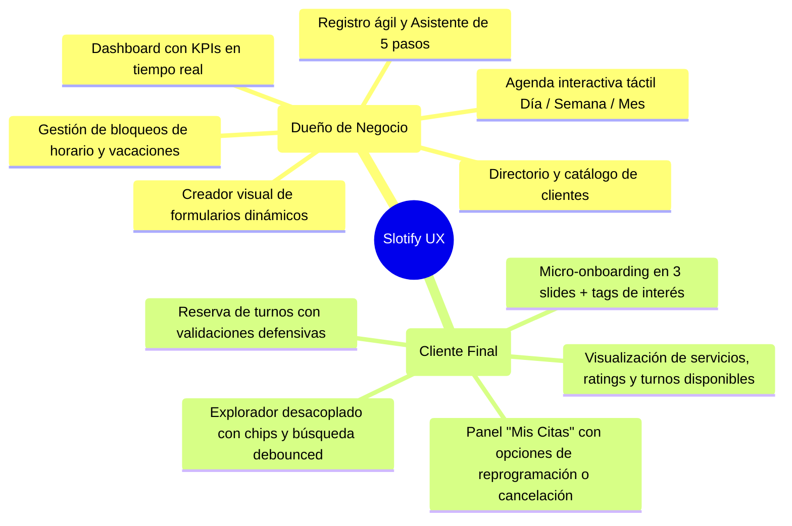

# 📑 Índice de Historias de Usuario UI

> [!info] Matriz de Requerimientos Frontend
> Esta sección documenta los requerimientos funcionales y criterios de aceptación orientados a la experiencia de usuario (UI/UX) para la aplicación cliente y panel de administración en React Native.

---

## 📋 Historias de Usuario Implementadas

| ID | Título de la Historia | Rol Principal | Pantalla / Componente Clave | Estado |
| :--- | :--- | :--- | :--- | :---: |
| **[[US-001 - Experiencia de Registro B2C y B2B]]** | Experiencia de Registro B2C y B2B | Consumidor / Administrador | `LoginScreen`, `RegisterScreen`, `RegisterClientScreen` | ✅ Implementado |
| **[[US-003 - Calendario Tactil y Seleccion de Turnos]]** | Calendario Táctil y Selección de Turnos | Administrador / Profesional | `CalendarView`, `DayView`, `WeekView`, `MonthView` | ✅ Implementado |
| **[[US-004 - Dashboard y Manejo de Estados Vacios (Empty States)]]** | Dashboard y Manejo de Estados Vacíos | Dueño de Negocio | `DashboardScreen`, `EmptyStateCard` | ✅ Implementado |
| **[[US-005 - Micro-Onboarding Interactivo del Consumidor]]** | Micro-Onboarding Interactivo del Consumidor | Consumidor Final (Cliente) | `ConsumerOnboardingScreen` | ✅ Implementado |
| **[[US-006 - Selector de Giro y Plantillas de Sector]]** | Selector de Giro y Plantillas de Sector | Dueño de Negocio | `SectorSelectionScreen`, `SectorTemplateCard` | ✅ Implementado |
| **[[US-020 - Creador Dinamico de Formularios (Form Builder)]]** | Creador Dinámico de Formularios (Form Builder) | Dueño de Negocio | `FormBuilderScreen`, `FormViewer`, `form-preview` | ✅ Implementado |
| **[[US-023 - Gestion de Bloqueos de Agenda y Citas]]** | Gestión de Bloqueos de Agenda y Citas | Administrador / Profesional | `BlockSlotModal`, `CalendarView` | ✅ Implementado |
| **[[US-026 - Directorio y Modulo de Clientes B2B]]** | Directorio y Módulo de Clientes B2B | Dueño de Negocio | `ClientsScreen` | ✅ Implementado |
| **[[Feature Business Detail & Adaptive Brand]]** | Experiencia Pública de Negocio e Identidad Visual Adaptativa (trazado a `US-023` Backend) | Cliente Consumidor (B2C) | `BusinessCard`, `BusinessDetailScreen`, `useBusinessBrand`, `BookingScreen` | ⚠️ Base e identidad completas; galería/portada/staff pendientes de DTO backend |

---

## 🎯 Arquitectura de Decisiones UX

---

## 🔗 Referencias Relacionadas
- Arquitectura FDD: [[Arquitectura y FDD]]
- Módulo de Autenticación: [[Feature Auth (UI)]]
- Flujo de Registro: [[Flujo de Registro y Sync con Supabase Auth]]
- MOC Principal: [[Indice General]]
