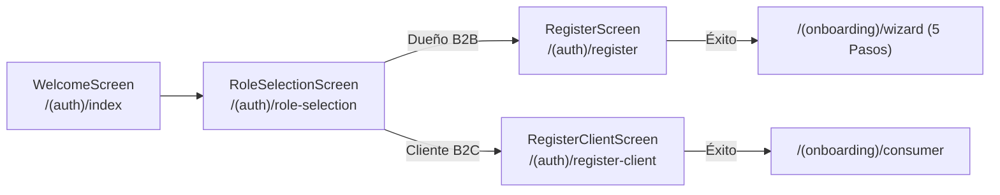

# 👤 US-001 - Experiencia de Registro B2C y B2B

> [!abstract] Descripción de la Historia
> **Como** usuario nuevo (cliente consumidor o dueño de negocio),
> **quiero** disponer de un flujo de registro diferenciado y adaptado a mi propósito,
> **para** acceder a las herramientas de gestión comercial de mi empresa o comenzar a agendar citas en mis negocios locales favoritos.

---

## 🎯 Criterios de Aceptación (Gherkin)

### Escenario 1: Registro exitoso como Dueño de Negocio (B2B)
- **Dado** que un usuario no autenticado ingresa a la portada (`WelcomeScreen`),
- **Cuando** selecciona *"Soy Dueño de Negocio"* en `RoleSelectionScreen` y completa `RegisterScreen` con nombre, correo y contraseña,
- **Y** presiona *"Continuar a Configurar Negocio"*,
- **Entonces** el sistema invoca `useAuthStore.register(...)`, crea la cuenta en Supabase con rol `DUENO`, guarda el token JWT en SecureStore y redirige de inmediato al asistente comercial [[Feature Business Onboarding]] (`/(onboarding)/wizard`).

### Escenario 2: Registro exitoso como Cliente Consumidor (B2C)
- **Dado** que un usuario desea registrarse para agendar turnos,
- **Cuando** accede a `RegisterClientScreen` e ingresa nombre, teléfono, correo y contraseña,
- **Y** presiona *"Crear mi Cuenta de Cliente"*,
- **Entonces** el sistema registra la cuenta con rol `CLIENTE` mediante `useAuthStore.registerClient(...)`, establece `appMode: 'CONSUMER'` y redirige a la pantalla de micro-onboarding [[Feature Consumer Onboarding]] (`/(onboarding)/consumer`).

### Escenario 3: Validación reactiva y feedback de error
- **Dado** que el usuario ingresa una contraseña corta (< 6 caracteres) o un correo ya registrado,
- **Cuando** intenta enviar el formulario,
- **Entonces** la UI intercepta el error mediante [[Gestion Centralizada de Errores (errorUtils)]], muestra un [[FormErrorBanner y FormFieldError]] en la parte superior y resalta el campo afectado con borde rojo semántico.

---

## 🖥️ Componentes y Vistas Involucradas

1. **`WelcomeScreen`:** Portada con animaciones continuas de tarjetas flotantes.
2. **`RoleSelectionScreen`:** Selector interactivo de modalidad (B2B vs B2C).
3. **`RegisterScreen`:** Formulario enfocado en administradores con feedback visual mediante `FormErrorBanner`.
4. **`RegisterClientScreen`:** Formulario enfocado en clientes finales con captura de teléfono celular.

---

## 🔗 Referencias Relacionadas
- Feature de Autenticación: [[Feature Auth (UI)]]
- Asistente de Negocio: [[Feature Business Onboarding]]
- Normalizador de Errores: [[Gestion Centralizada de Errores (errorUtils)]]
- Componentes de UI: [[FormErrorBanner y FormFieldError]]
- MOC Principal: [[Indice General]]
