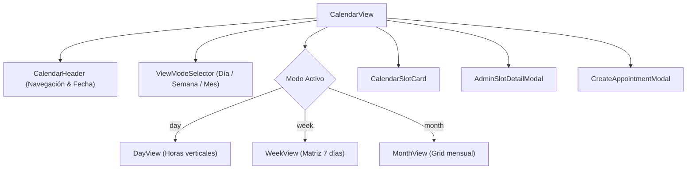

# 📅 US-003 - Calendario Táctil y Selección de Turnos

> [!abstract] Descripción de la Historia
> **Como** administrador o profesional del negocio,
> **quiero** disponer de un calendario interactivo multiformato (Día, Semana y Mes) con controles táctiles fluidos,
> **para** visualizar turnos agendados, crear citas inmediatas, gestionar bloqueos y cambiar rápidamente de fecha sin tiempos de espera.

---

## 🎯 Criterios de Aceptación (Gherkin)

### Escenario 1: Conmutación de Modo de Vista (Día / Semana / Mes)
- **Dado** que el usuario se encuentra en la pantalla de Agenda (`/(main)/agenda`),
- **Cuando** pulsa los botones de alternancia en `ViewModeSelector` (*Día*, *Semana*, *Mes*),
- **Entonces** el estado reactivo `useCalendarStore.viewMode` se actualiza inmediatamente y el layout renderiza el subcomponente correspondiente (`DayView`, `WeekView` o `MonthView`) sin recargas completas de pantalla.

### Escenario 2: Navegación Cronológica Suave
- **Dado** que el usuario presiona las flechas de navegación previa/siguiente o *"Hoy"* en `CalendarHeader`,
- **Cuando** se ejecuta la acción `navigateForward()`, `navigateBackward()` o `goToToday()`,
- **Entonces** el componente recalcula el rango de visualización activo y preserva los datos de slots en memoria si corresponden al mismo período mensual.

### Escenario 3: Interacción Directa con el Slot y Apertura de Modales
- **Dado** que se muestran slots en pantalla con estados (*disponible*, *confirmado*, *pendiente*, *bloqueado*),
- **Cuando** el usuario toca un slot de cita,
- **Entonces** se despliega el modal `AdminSlotDetailModal` con información detallada del cliente, servicio y opciones para cambiar estado (`confirmed`, `completed`, `cancelled`), reprogramar o eliminar.

---

## 🏗️ Jerarquía Visual de Componentes



---

## 💻 Tipos y Estados de Slot

```typescript
// src/shared/types/index.ts
export type CalendarViewMode = 'day' | 'week' | 'month';
export type SlotStatus = 'available' | 'reserved' | 'blocked' | 'confirmed' | 'pending' | 'completed' | 'cancelled';

export interface CalendarSlot {
  id: string;
  resourceId: string;
  startTime: string; // ISO 8601
  endTime: string;   // ISO 8601
  status: SlotStatus;
  type?: 'slot' | 'appointment' | 'block';
  title?: string;
  clientName?: string;
  clientPhone?: string;
  servicePrice?: string;
}
```

---

## 🔗 Referencias Relacionadas
- Feature UI: [[Feature Calendar & Booking]]
- Store de Calendario: [[Estado Global y Stores]]
- Cliente API: [[Slotify API Client]]
- Flujo de interacción: [[Flujo de Agendamiento y Formularios Dinamicos]]
