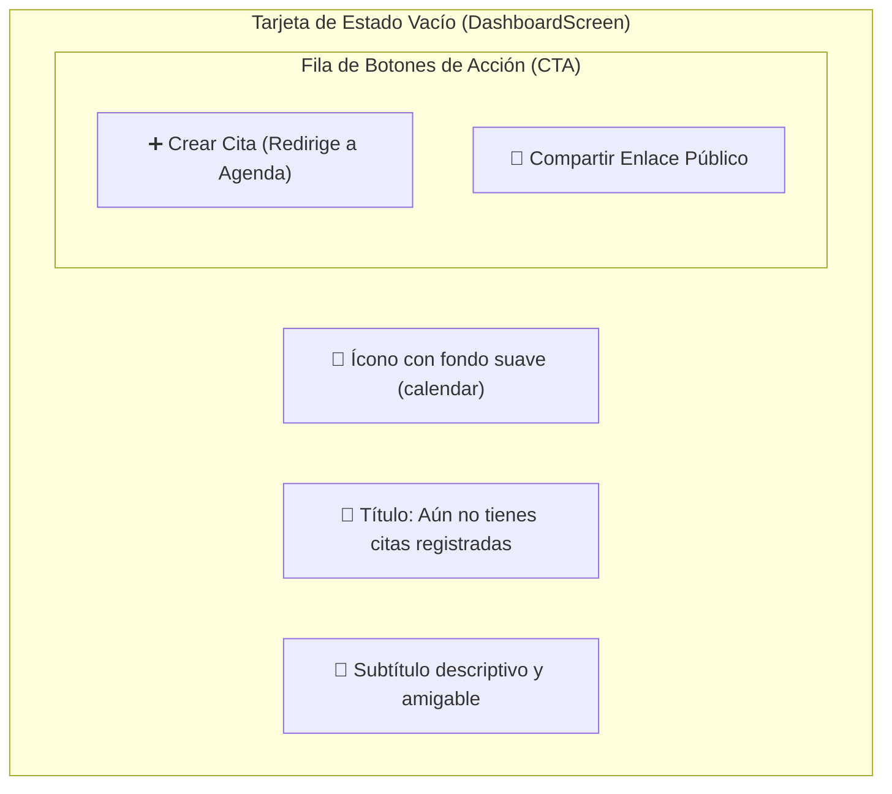

# 📊 US-004 - Dashboard y Manejo de Estados Vacíos (Empty States)

> [!abstract] Descripción de la Historia
> **Como** administrador de un negocio recién registrado o con baja actividad,
> **quiero** ver un panel de control con métricas claras y componentes visuales atractivos cuando no existan citas agendadas,
> **para** comprender el estado de mi operación y acceder a llamadas a la acción (*Call to Action*) guiadas que me ayuden a configurar mi agenda y compartir mi enlace de reservas.

---

## 🎯 Criterios de Aceptación (Gherkin)

### Escenario 1: Renderizado dinámico de KPIs con datos reales o demo
- **Dado** que el usuario ingresa a `DashboardScreen` (`/(main)`),
- **Cuando** se cargan los slots del mes actual,
- **Entonces** las tarjetas de estadísticas calculan en tiempo real:
  - *Citas Hoy:* Conteo de turnos del día no cancelados.
  - *Clientes:* Conteo de clientes únicos registrados.
  - *Ingresos Hoy:* Sumatoria monetaria de servicios confirmados y completados.
  - *Pendientes:* Conteo de citas por confirmar.

### Escenario 2: Despliegue de Empty State Informativo
- **Dado** que un negocio no posee citas agendadas (`appointments.length === 0`),
- **Cuando** se visualiza la sección *"Próximas Citas"*,
- **Entonces** en lugar de una lista en blanco o mensaje estático, se renderiza la tarjeta de estado vacío con:
  1. Ícono estilizado con resplandor (`Feather name="calendar"`).
  2. Título: *"Aún no tienes citas registradas"*.
  3. Subtítulo orientativo con instrucciones de uso.
  4. Botón primario *"Crear Cita"* que redirige a `/(main)/agenda`.
  5. Botón secundario *"Compartir"* que invoca el diálogo nativo `Share.share` con el enlace público de reservas.

---

## 🎨 Anatomía del Empty State Card



---

## 💻 Fragmento de Implementación: Cálculo de Métricas y Empty State

```tsx
// src/features/dashboard/ui/screens/DashboardScreen.tsx
const stats = useMemo(() => {
  if (appointments.length > 0) {
    const today = new Date();
    const todayAppointments = appointments.filter(
      (s) => isSameDay(new Date(s.startTime), today) && s.status !== 'cancelled'
    );
    const uniqueClients = new Set(
      appointments.map((s) => s.clientName || s.clientPhone).filter(Boolean)
    ).size;
    const todayRevenue = todayAppointments
      .filter((s) => s.status === 'completed' || s.status === 'confirmed')
      .reduce((sum, s) => {
        const num = parseFloat((s.servicePrice || '0').replace(/[^0-9.]/g, ''));
        return sum + (isNaN(num) ? 0 : num);
      }, 0);

    return [
      { label: 'Citas Hoy', value: String(todayAppointments.length), icon: 'calendar', color: '#6366F1' },
      { label: 'Clientes', value: String(uniqueClients), icon: 'users', color: '#10B981' },
      { label: 'Ingresos Hoy', value: `$${todayRevenue.toLocaleString('es-MX')} MXN`, icon: 'dollar-sign', color: '#F59E0B' },
      { label: 'Pendientes', value: String(appointments.filter(s => s.status === 'pending').length), icon: 'clock', color: '#EC4899' },
    ];
  }
  // Valores por defecto para onboarding inicial
  return DEFAULT_EMPTY_STATS;
}, [appointments]);
```

---

## 🔗 Referencias Relacionadas
- Feature UI: [[Feature Business Dashboard]]
- Componente UI Kit: [[EmptyStateCard]]
- Sistema de Diseño: [[Sistema de Diseno y Tokens]]
- MOC Principal: [[Indice General]]
