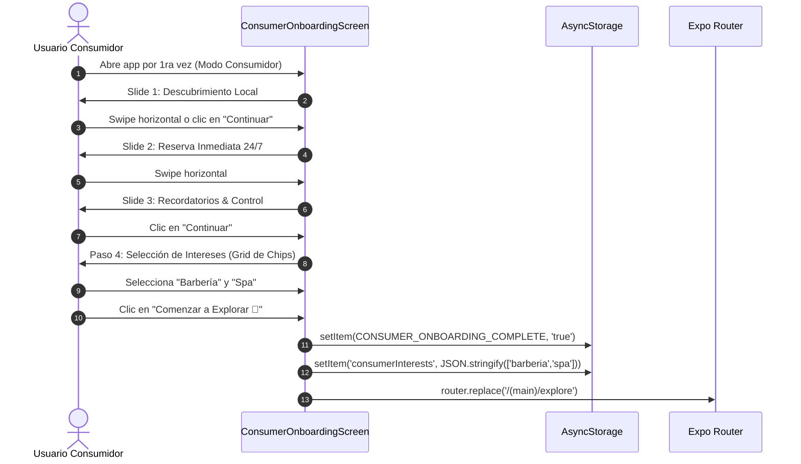

# ✨ US-005 - Micro-Onboarding Interactivo del Consumidor

> [!abstract] Descripción de la Historia
> **Como** nuevo cliente consumidor (B2C),
> **quiero** experimentar una inducción interactiva corta y elegir mis categorías de interés en mi primer acceso,
> **para** familiarizarme con el proceso de reserva y recibir sugerencias personalizadas en el explorador de negocios.

---

## 🎯 Criterios de Aceptación (Gherkin)

### Escenario 1: Navegación por Carrusel Horizontal de Beneficios
- **Dado** que el usuario cliente ingresa a `/(onboarding)/consumer`,
- **Cuando** desliza horizontalmente entre los 3 primeros slides (*Descubrimiento Local*, *Reserva Inmediata 24/7*, *Recordatorios & Control*),
- **Entonces** el indicador de puntos (*dots*) inferior se anima fluidamente marcando el slide activo mediante `react-native-reanimated`.

### Escenario 2: Selección Multicategoría de Intereses
- **Dado** que el usuario avanza al cuarto paso del onboarding (*Personaliza tu Experiencia*),
- **Cuando** pulsa chips de categorías (*Barbería*, *Estética*, *Spa*, *Salud*, *Uñas*, *Tatuajes*),
- **Entonces** los chips alternan visualmente su borde activo, color de acento y marca de verificación (*checkmark*), almacenándose en el estado local `selectedInterests`.

### Escenario 3: Finalización y Guardado en AsyncStorage
- **Dado** que el usuario presiona el botón *"Comenzar a Explorar 🚀"* o pulsa *"Omitir"*,
- **Cuando** se ejecuta la función `handleFinish()`,
- **Entonces** el sistema persiste la clave `consumerOnboardingComplete: 'true'` y `consumerInterests: [...]` en `AsyncStorage`, navegando de forma permanente hacia `/(main)/explore`.

---

## 📱 Estructura de Pasos del Micro-Onboarding



---

## 💻 Categorías Disponibles

```typescript
// src/features/consumer-onboarding/ui/ConsumerOnboardingScreen.tsx
const INTEREST_CATEGORIES = [
  { id: 'barberia', name: 'Barbería y Estilo', icon: 'scissors-cutting', color: '#6366F1' },
  { id: 'belleza', name: 'Salón y Estética', icon: 'face-woman-shimmer', color: '#EC4899' },
  { id: 'spa', name: 'Spa y Masajes', icon: 'spa', color: '#10B981' },
  { id: 'salud', name: 'Salud y Consultorios', icon: 'medical-bag', color: '#06B6D4' },
  { id: 'unas', name: 'Uñas y Pestañas', icon: 'hand-peace', color: '#8B5CF6' },
  { id: 'tatuajes', name: 'Tatuajes y Arte', icon: 'palette', color: '#F59E0B' },
];
```

---

## 🔗 Referencias Relacionadas
- Feature UI: [[Feature Consumer Onboarding]]
- Explorador: [[Feature Consumer Dashboard & Explore]]
- Flujo interactivo: [[Flujo de Micro-Onboarding y Feed Inicial]]
- Almacenamiento local: [[Offline Storage y Cache]]
