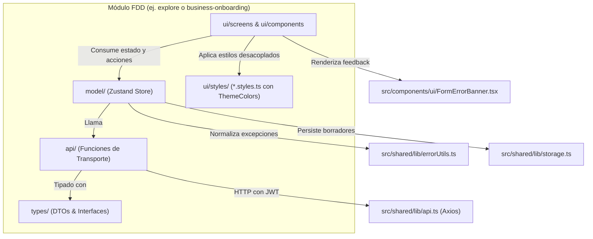

# 🏗️ Arquitectura y Feature-Driven Development (FDD)

> [!abstract] Resumen de Arquitectura
> El frontend de **Slotify** implementa una arquitectura modular guiada por funcionalidades (**Feature-Driven Development** o FDD), combinada con principios de **Clean Architecture** y el patrón **MVVM** (Model-View-ViewModel) en React Native con **Expo Router v4**.
> Esta estructura asegura alta cohesión interna, bajo acoplamiento entre dominios, facilidad para pruebas unitarias y escalabilidad técnica.

---

## 🏛️ Principios Fundamentales del Diseño

1. **Aislamiento por Dominio de Negocio (`src/features/*`):**
   Cada módulo funcional encapsula sus propias pantallas, componentes atómicos, lógica de estado (stores Zustand), llamadas a endpoints de red y definiciones de tipos TypeScript.
2. **Patrón Model-View-ViewModel (MVVM):**
   - **View (`ui/`):** Componente pasivo que consume el estado reactivo, renderiza la interfaz y despacha eventos del usuario.
   - **ViewModel (`model/`):** Almacena el estado inmutable mediante Zustand, contiene la lógica de negocio del cliente y sobrevive a los ciclos de renderizado.
   - **Data Layer (`api/`):** Funciones puras encargadas del transporte HTTP (vía `apiClient`) o SDK de Supabase.
   - **Domain Types (`types/`):** Contratos de datos específicos del módulo.
3. **Estilos Desacoplados con Tokens (`ui/styles/*`):**
   Los estilos complejos se extraen en archivos dedicados (`*.styles.ts`) mediante funciones factoría que reciben `colors: ThemeColors` para garantizar compatibilidad con modo claro y oscuro sin recompilar estilos inline.
4. **Capa Transversal Compartida (`src/shared/*` y `src/components/*`):**
   Módulos de infraestructura reutilizables por cualquier feature (cliente HTTP, autenticación Supabase, almacenamiento seguro, biblioteca de normalización de errores, tokens de diseño y primitivas animadas).

---

## 📁 Inventario Estructural del Directorio `src/`

```
src/
├── app/                        # 🧭 Enrutamiento basado en archivos (Expo Router v4)
│   ├── (auth)/                 # Rutas de autenticación (Login, Register, Role, Onboarding)
│   ├── (onboarding)/           # Flujos de inducción (Wizard B2B de 5 pasos, Consumer Onboarding)
│   ├── (main)/                 # Rutas autenticadas con FloatingTabBar (Dashboard, Agenda, Explore, etc.)
│   ├── book/[slug].tsx         # Ruta pública web y móvil para agendamiento directo
│   └── _layout.tsx             # Root layout: SplashScreen, providers, tipografía y guards
├── components/                 # 🎨 Componentes compartidos y UI Kit transversal
│   ├── animated-icon/          # Splash overlay animado de inicio
│   └── ui/                     # Primitivas animadas (FluidButton, FormErrorBanner, Toast, etc.)
├── features/                   # 🧩 13 Módulos de Dominio (FDD)
│   ├── auth/                   # Autenticación, sesión y roles (DUENO vs CLIENTE)
│   ├── booking/                # Formularios dinámicos y confirmación de reservas
│   ├── business-onboarding/    # Wizard B2B de 5 pasos para configuración del negocio
│   ├── calendar/               # Calendario interactivo, vistas táctiles (Día/Semana/Mes) y slots
│   ├── clients/                # Directorio y catálogo de clientes para administradores
│   ├── consumer-dashboard/     # Vista de "Mis Citas" del consumidor
│   ├── consumer-onboarding/    # Micro-onboarding de 3 slides e intereses para clientes
│   ├── dashboard/              # Dashboard B2B, KPIs, FormViewer y FormBuilderScreen
│   ├── explore/                # Explorador independiente de comercios y filtros reactivos
│   ├── profile/                # Perfil de usuario, cuenta y modo de visualización
│   ├── schedule-blocks/        # Bloqueos manuales de horario y prevención de solapamiento
│   ├── sector-templates/       # Plantillas preconfiguradas por giro (barbería, estética, etc.)
│   └── settings/               # Ajustes comerciales, horarios y modales de edición
└── shared/                     # 🔌 Infraestructura y Core del Sistema
    ├── lib/                    # apiClient, supabase, storage, errorUtils, constants
    ├── theme/                  # Tokens de color Dark Charcoal, tipografía, espaciado y useTheme
    └── types/                  # Tipados globales compartidos
```

---

## 📐 Anatomía Interna de un Módulo FDD

Cada feature dentro de `src/features/<feature-name>` aplica la siguiente estructura estándar:

```
src/features/<feature-name>/
├── api/                        # Funciones de consumo REST o llamadas Supabase
│   └── index.ts (o <feature>Api.ts)
├── model/                      # Store de Zustand (ViewModel), selectores y lógica de estado
│   └── index.ts (o <feature>Store.ts)
├── types/                      # Interfaces TypeScript específicas del dominio
│   └── index.ts (o <feature>.types.ts)
├── ui/                         # Interfaz gráfica
│   ├── screens/                # Vistas de pantalla completa consumidas por app/
│   ├── components/             # Subcomponentes visuales específicos de la feature
│   └── styles/                 # Estilos desacoplados factorizados por ThemeColors
├── __tests__/                  # Pruebas unitarias de la feature (opcional por módulo)
└── index.ts                    # Barril de exportación pública
```



---

## 🔗 Referencias Relacionadas
- Enrutamiento: [[Enrutamiento y Navegacion]]
- Sistema de Estado: [[Estado Global y Stores]]
- Cliente API: [[Slotify API Client]]
- Gestión de Errores: [[Gestion Centralizada de Errores (errorUtils)]]
- Componentes de UI: [[FormErrorBanner y FormFieldError]]
- MOC Principal: [[Indice General]]
