# 🧭 Enrutamiento y Navegación con Expo Router

> [!abstract] Resumen de Enrutamiento
> **Slotify** implementa **Expo Router v4** (enrutamiento declarativo basado en el sistema de archivos), estructurado en grupos de rutas protegidas mediante paréntesis (`(auth)`, `(onboarding)`, `(main)`), layouts anidados, guardias automáticos de sesión en el layout raíz y soporte para rutas dinámicas como `/book/[slug]`.

---

## 🗺️ Árbol de Rutas del Sistema

```mermaid
graph TD
    Root["src/app/_layout.tsx (Root Stack & Guards)"] --> Index["src/app/index.tsx (Entry Redirect)"]
    Root --> AuthGroup["src/app/(auth)/_layout.tsx"]
    Root --> OnbGroup["src/app/(onboarding)/_layout.tsx"]
    Root --> MainGroup["src/app/(main)/_layout.tsx (Tabs con FloatingTabBar)"]
    Root --> BookSlug["src/app/book/[slug].tsx (Reserva Pública)"]

    subgraph AuthRoutes ["Grupo (auth) — Sin Sesión Activa"]
        AuthGroup --> AuthIndex["(auth)/index (WelcomeScreen)"]
        AuthGroup --> AuthLogin["(auth)/login (LoginScreen)"]
        AuthGroup --> AuthRole["(auth)/role-selection (RoleSelectionScreen)"]
        AuthGroup --> AuthReg["(auth)/register (RegisterScreen B2B)"]
        AuthGroup --> AuthRegClient["(auth)/register-client (RegisterClientScreen B2C)"]
        AuthGroup --> AuthSuccess["(auth)/register-success"]
        AuthGroup --> AuthOnb["(auth)/onboarding (Bridge a Wizard)"]
    end

    subgraph OnboardingRoutes ["Grupo (onboarding) — Configuración Inicial"]
        OnbGroup --> OnbWizard["(onboarding)/wizard (Wizard B2B de 5 pasos)"]
        OnbGroup --> OnbConsumer["(onboarding)/consumer (Micro-Onboarding B2C)"]
        OnbGroup --> OnbSector["(onboarding)/sector-selection (Plantillas de sector)"]
    end

    subgraph MainRoutes ["Grupo (main) — Aplicación Principal con FloatingTabBar"]
        MainGroup --> MainHome["(main)/index (Dashboard B2B o Mis Citas B2C)"]
        MainGroup --> MainAgenda["(main)/agenda (Agenda B2B)"]
        MainGroup --> MainExplore["(main)/explore (Explorador B2C)"]
        MainGroup --> MainClients["(main)/clients (Directorio de Clientes B2B)"]
        MainGroup --> MainSettings["(main)/settings (Ajustes B2B / Perfil B2C)"]
        MainGroup --> MainFB["(main)/form-builder (Editor de Formularios)"]
        MainGroup --> MainFP["(main)/form-preview (Previsualización)"]
    end
```



---

## 🛡️ Guardias de Rutas en `RootLayout` (`src/app/_layout.tsx`)

El layout raíz no solo inicializa fuentes y tema, sino que actúa como **guardián central de navegación**, verificando el estado de autenticación y los flags de inducción antes de renderizar cualquier vista:

```tsx
// Lógica de redirección en src/app/_layout.tsx
useEffect(() => {
  if (isHydrating || !fontsLoaded) return;

  const inAuthGroup = segments[0] === '(auth)';
  const inMainGroup = segments[0] === '(main)';
  const inOnboardingGroup = segments[0] === '(onboarding)';

  // 1. Usuario No Autenticado
  if (!isAuthenticated) {
    if (inMainGroup || inOnboardingGroup) {
      router.replace('/(auth)');
    }
    return;
  }

  // 2. Usuario Autenticado: verificar finalización de Onboarding
  if (inAuthGroup) {
    if (appMode === 'CONSUMER' || user?.role === 'CLIENTE') {
      const hasCompletedConsumer = storage.get(STORAGE_KEYS.CONSUMER_ONBOARDING_COMPLETE);
      if (!hasCompletedConsumer) {
        router.replace('/(onboarding)/consumer');
      } else {
        router.replace('/(main)');
      }
    } else {
      // Dueño de Negocio (B2B)
      const hasCompletedBusiness = storage.get(STORAGE_KEYS.ONBOARDING_COMPLETE);
      if (!hasCompletedBusiness) {
        router.replace('/(onboarding)/wizard');
      } else {
        router.replace('/(main)');
      }
    }
  }
}, [isAuthenticated, isHydrating, fontsLoaded, segments]);
```

---

## 🎛️ Navegación Condicional por Rol (`FloatingTabBar`)

Dentro del grupo `(main)`, el archivo `src/app/(main)/_layout.tsx` utiliza [[FloatingTabBar]], el cual filtra las pestañas mostradas según el valor de `appMode`:

| Pestaña | Modo Negocio (B2B) | Modo Consumidor (B2C) | Archivo de Pantalla |
| :--- | :---: | :---: | :--- |
| `index` | **Dashboard KPIs** | **Mis Citas** | `src/features/dashboard` / `consumer-dashboard` |
| `agenda` | **Agenda Interactiva** | *Oculta* | `src/features/calendar` |
| `clients` | **Directorio Clientes** | *Oculta* | `src/features/clients` |
| `explore` | *Oculta* | **Explorador Comercios** | `src/features/explore` |
| `settings` | **Ajustes Comerciales** | **Mi Perfil** | `src/features/settings` / `profile` |

---

## 🔗 Referencias Relacionadas
- Barra Flotante: [[FloatingTabBar]]
- Módulo de Autenticación: [[Feature Auth (UI)]]
- Onboarding B2B: [[Feature Business Onboarding]]
- Explorador: [[Feature Explore]]
- MOC Principal: [[Indice General]]
