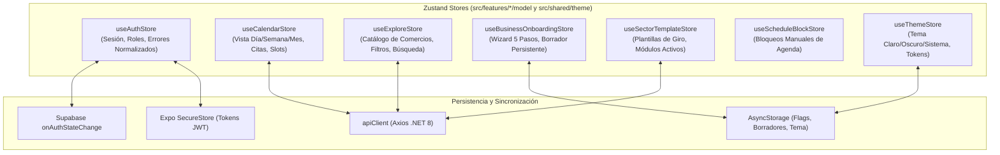

# ⚡ Estado Global y Stores con Zustand

> [!abstract] Resumen del Manejo de Estado
> **Slotify** implementa el patrón **ViewModel** en React Native mediante **Zustand**. Este enfoque proporciona un estado reactivo, inmutable, ligero y completamente desacoplado del árbol de renderizado de React, con integración bidireccional a **Supabase Auth**, **AsyncStorage**, **Expo SecureStore** y la capa de normalización de errores [[Gestion Centralizada de Errores (errorUtils)]].

---

## 🏬 Panorama de Stores en el Proyecto



---

## 1. `useAuthStore` — Autenticación y Modalidad Dual
Ubicado en `src/features/auth/model/index.ts`.

### Estado y Acciones
```typescript
export type AppMode = 'BUSINESS' | 'CONSUMER';

interface AuthState {
  user: AuthUser | null;
  isAuthenticated: boolean;
  isLoading: boolean;
  isHydrating: boolean;
  error: string | null;
  formError: NormalizedError | null;
  appMode: AppMode;
  isJustRegistered: boolean;

  // Acciones
  setAppMode: (mode: AppMode) => void;
  toggleAppMode: () => void;
  login: (credentials: LoginCredentials) => Promise<void>;
  register: (data: RegisterAdminRequest) => Promise<void>;
  registerClient: (data: RegisterClientRequest) => Promise<void>;
  logout: () => Promise<void>;
  hydrate: () => Promise<void>;
  clearError: () => void;
}
```

### Características Clave
- **Captura Tipada de Errores:** Almacena `formError: NormalizedError | null` procesado con `normalizeError`, facilitando que pantallas como `LoginScreen` y `RegisterScreen` alimenten automáticamente a `FormErrorBanner`.
- **Sincronización Supabase:** Reacciona a eventos `SIGNED_IN` y `SIGNED_OUT` en segundo plano.

---

## 2. `useBusinessOnboardingStore` — Asistente de Configuración B2B
Ubicado en `src/features/business-onboarding/model/businessOnboardingStore.ts`.

### Estado y Acciones
```typescript
interface BusinessOnboardingState {
  currentStep: number; // Pasos 1 a 5
  draft: BusinessOnboardingDraft;
  isLoading: boolean;
  isSavingDraft: boolean;
  error: NormalizedError | null;

  setStep: (step: number) => void;
  nextStep: () => void;
  prevStep: () => void;
  updateBusinessData: (data: Partial<Step1BusinessData>) => void;
  updateSectorData: (data: Partial<Step2SectorData>) => void;
  updateServicesData: (data: Partial<Step3ServicesData>) => void;
  updateHoursData: (data: Partial<Step4HoursData>) => void;
  submitCompleteOnboarding: () => Promise<boolean>;
  loadDraft: () => Promise<void>;
  clearDraft: () => Promise<void>;
  clearError: () => void;
}
```

### Características Clave
- **Persistencia de Borrador:** Guarda automáticamente en AsyncStorage cada cambio en los 5 pasos, permitiendo al usuario cerrar la app y reanudar la configuración sin perder datos.
- **Transmisión Atómica:** `submitCompleteOnboarding()` consolida el borrador y lo envía al endpoint `/onboarding/complete-business-onboarding`.

---

## 3. `useExploreStore` — Explorador y Catálogo de Negocios
Ubicado en `src/features/explore/model/index.ts`.

### Estado y Acciones
```typescript
interface ExploreState {
  businesses: BusinessItem[];
  filteredBusinesses: BusinessItem[];
  selectedCategory: string; // 'Todos', 'Barbería', 'Estética', etc.
  searchQuery: string;
  isLoading: boolean;
  error: string | null;

  fetchBusinesses: () => Promise<void>;
  setSelectedCategory: (category: string) => void;
  setSearchQuery: (query: string) => void;
  retry: () => void;
}
```

### Características Clave
- **Filtrado Multicriterio en Memoria:** Combina búsqueda de texto con selección de sector.
- **Resiliencia:** Si la API no responde, conserva datos o expone estados de error procesables con reintento.

---

## 4. `useCalendarStore` — Agenda y Disponibilidad
Ubicado en `src/features/calendar/model/index.ts`.

### Estado y Acciones
```typescript
interface CalendarState {
  viewMode: CalendarViewMode; // 'day' | 'week' | 'month'
  selectedDate: Date;
  slots: CalendarSlot[];
  isLoading: boolean;
  error: string | null;

  setViewMode: (mode: CalendarViewMode) => void;
  setSelectedDate: (date: Date) => void;
  goToToday: () => void;
  navigateForward: () => void;
  navigateBackward: () => void;
  loadSlots: () => Promise<void>;
  addSlot: (slot: CalendarSlot) => void;
  removeSlot: (resourceId: string) => void;
  updateSlotStatus: (resourceId: string, status: AppointmentStatus) => void;
}
```

---

## 5. `useSectorTemplateStore` — Plantillas por Industria
Ubicado en `src/features/sector-templates/model/index.ts`.
- Gestiona plantillas preconfiguradas para barberías, spas, clínicas y restaurantes (US-006 / US-002).
- Permite activar o desactivar módulos funcionales (control de inventario, anticipos, catálogo de servicios).

---

## 6. `useScheduleBlockStore` — Bloqueos de Horario
Ubicado en `src/features/schedule-blocks/model/index.ts`.
- Mantiene el formulario para crear bloqueos temporales de agenda (US-023), asegurando coherencia temporal antes de invocar la API.

---

## 7. `useThemeStore` (`useAppTheme`) — Sistema de Tema
Ubicado en `src/shared/theme/useTheme.ts`.
- Controla el modo actual (`light`, `dark`, `system`), resuelve los tokens `colors: ThemeColors` y persiste la selección en AsyncStorage.

---

## 🔗 Referencias Relacionadas
- Arquitectura FDD: [[Arquitectura y FDD]]
- Onboarding de Negocio: [[Feature Business Onboarding]]
- Explorador: [[Feature Explore]]
- Normalización de Errores: [[Gestion Centralizada de Errores (errorUtils)]]
- MOC Principal: [[Indice General]]
