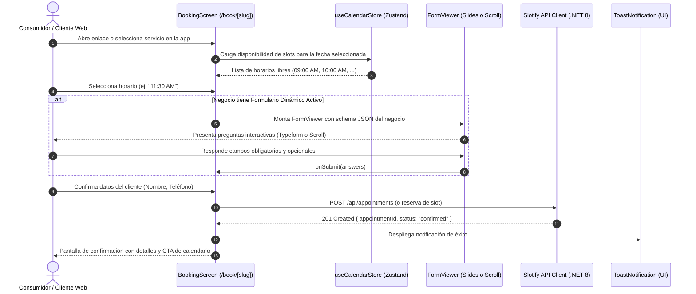

# 📅 Flujo de Agendamiento y Formularios Dinámicos

> [!abstract] Resumen del Flujo
> Describe el proceso completo mediante el cual un usuario (desde el explorador de la app o a través de la ruta web pública `/book/[slug]`) selecciona un servicio, elige fecha y horario disponible, responde un formulario dinámico configurable y confirma la reserva.

---

## 🔄 Diagrama de Secuencia

---

## 📋 Estilos de Presentación del Formulario Dinámico

El componente [[FormViewer]] soporta dos modos configurables por el administrador:
1. **Interactive Slides (`interactive_slides`):** Experiencia estilo *Typeform* pantalla a pantalla con barra de progreso superior animada y auto-avance en preguntas de opción única.
2. **Classic Scroll (`classic_scroll`):** Formulario tradicional vertical estilo *Google Forms* con validaciones integradas antes de enviar.

---

## 🔗 Referencias Relacionadas
- Requerimiento: [[US-003 - Calendario Tactil y Seleccion de Turnos]]
- Feature UI: [[Feature Calendar & Booking]]
- Componente FormViewer: [[FormViewer]]
- Explorador: [[Feature Consumer Dashboard & Explore]]
