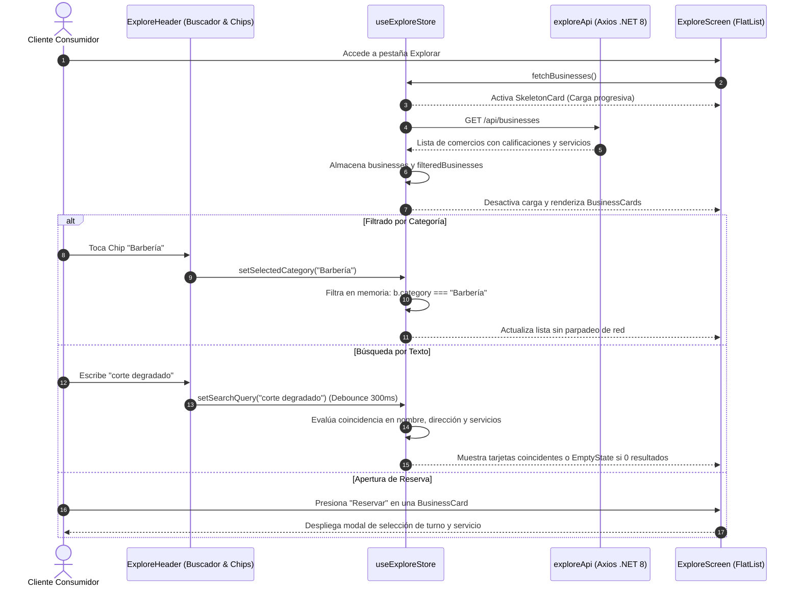

# 🔍 Flujo de Exploración y Filtros de Negocio

> [!abstract] Resumen del Flujo
> Describe el proceso interactivo de descubrimiento comercial mediante el cual el cliente consumidor explora negocios cercanos, filtra por categoría de servicio en chips horizontales y busca en tiempo real por texto con retardo (*debounce*).

---

## ⚡ Diagrama de Interacción del Explorador

---

## 🛡️ Rendimiento y Usabilidad

1. **Búsqueda Instantánea con Debounce:** Previene cálculos innecesarios al esperar 300 ms tras la última pulsación de tecla.
2. **Filtrado en Memoria (Zero Latency):** Las categorías y términos se resuelven en memoria local tras la primera descarga, logrando transiciones instantáneas a 60 fps.
3. **Pull-to-Refresh:** Permite al cliente deslizar hacia abajo para forzar una recarga fresca del catálogo desde el servidor.

---

## 🔗 Referencias Relacionadas
- Feature de Explorador: [[Feature Explore]]
- Micro-Onboarding: [[Feature Consumer Onboarding]]
- Calendario y Turnos: [[Feature Calendar & Booking]]
- MOC Principal: [[Indice General]]
