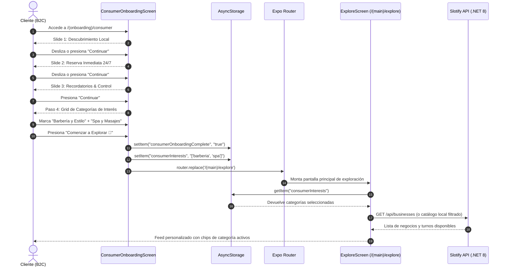

# 🚀 Flujo de Micro-Onboarding y Feed Inicial

> [!abstract] Resumen del Flujo
> Este flujo describe la primera interacción que experimenta un cliente final (B2C) al registrarse o abrir la aplicación por primera vez, abarcando la presentación de valor, la selección interactiva de intereses y la carga inicial del feed de comercios.

---

## 🔄 Diagrama de Secuencia

---

## 📋 Pasos Detallados del Flujo

1. **Evaluación de Primera Sesión:**
   Al iniciar la aplicación, el layout evalúa si la clave `consumerOnboardingComplete` está presente. Si no existe y el usuario tiene rol `CLIENTE`, se le dirige a `/(onboarding)/consumer`.
2. **Presentación de Propuesta de Valor:**
   Carrusel con 3 tarjetas visuales que destacan:
   - Descubrimiento geolocalizado de especialistas y comercios verificados.
   - Disponibilidad en vivo y reserva sin intermediarios.
   - Recordatorios y gestión de reagendamiento.
3. **Selección de Preferencias:**
   Grid con chips que permiten multiselección dinámica con feedback háptico y visual.
4. **Persistencia e Hidratación del Feed:**
   Se almacena la configuración y el feed en `explore.tsx` prioriza automáticamente los comercios asociados a los intereses marcados.

---

## 🔗 Referencias Relacionadas
- Requerimiento: [[US-005 - Micro-Onboarding Interactivo del Consumidor]]
- Feature UI: [[Feature Consumer Onboarding]]
- Explorador: [[Feature Consumer Dashboard & Explore]]
- Almacenamiento: [[Offline Storage y Cache]]
