# 🔄 Flujo de Onboarding de Negocio (Wizard B2B)

> [!abstract] Resumen del Flujo
> Describe la interacción paso a paso entre el usuario administrador recién registrado (`DUENO`), la pantalla `BusinessOnboardingWizardScreen.tsx`, el store `useBusinessOnboardingStore` con persistencia en borrador y el backend en .NET 8 para configurar y activar el comercio.

---

## 🪜 Diagrama de Secuencia del Asistente B2B

```mermaid
sequenceDiagram
    autonumber
    actor Admin as Administrador (Dueño)
    participant UI as BusinessOnboardingWizardScreen
    participant Store as useBusinessOnboardingStore
    participant Storage as AsyncStorage (Borrador)
    participant API as businessOnboardingApi (.NET 8)

    Admin->>UI: Ingresa tras registro o login sin negocio configurado
    UI->>Store: loadDraft()
    Store->>Storage: get('business_onboarding_draft')
    Storage-->>Store: Borrador previo o estado inicial
    Store-->>UI: Restaura paso actual y campos guardados

    rect rgb(30, 30, 45)
        note right of Admin: Paso 1: Selección de Giro Comercial
        Admin->>UI: Elige categoría (ej. Barbería)
        UI->>Store: setCategory("Belleza y Cuidado Personal")
        Store->>Storage: set('business_onboarding_draft', payload)
        Admin->>UI: Presiona Siguiente
    end

    rect rgb(30, 30, 45)
        note right of Admin: Paso 2: Identidad del Negocio
        Admin->>UI: Ingresa Nombre Comercial y Teléfono
        UI->>Store: setBusinessName("Barbería Clásica")
        Store->>Store: Calcula slug sanitizado: "barberia-clasica"
        Admin->>UI: Presiona Siguiente
    end

    rect rgb(30, 30, 45)
        note right of Admin: Paso 3: Horarios de Atención
        Admin->>UI: Marca días laborales (Lunes-Viernes) y rango (09:00 - 18:00)
        UI->>Store: updateHoursData(...)
        Admin->>UI: Presiona Siguiente
    end

    rect rgb(30, 30, 45)
        note right of Admin: Paso 4: Configuración de Servicio Inicial
        Admin->>UI: Define Servicio Base (Nombre, Minutos, Precio)
        UI->>Store: updateServicesData(...)
        Admin->>UI: Presiona Siguiente
    end

    rect rgb(30, 30, 45)
        note right of Admin: Paso 5: Confirmación y Lanzamiento
        Admin->>UI: Revisa resumen final y presiona "Completar y Activar"
        UI->>Store: submitCompleteOnboarding()
        Store->>API: POST /api/onboarding/complete-business-onboarding
        alt Respuesta Exitosa (HTTP 200/201)
            API-->>Store: Confirmación de activación
            Store->>Storage: set(STORAGE_KEYS.ONBOARDING_COMPLETE, true)
            Store->>Storage: clearDraft()
            Store-->>UI: Éxito (Navegación permitida)
            UI-->>Admin: Redirección inmediata a (main)/index (Dashboard)
        else Error de Validación o Red
            API-->>Store: Error 400 / 500
            Store-->>UI: Despliega FormErrorBanner con detalles
        end
    end
```

---

## 🛡️ Puntos de Control y Resiliencia

1. **Persistencia Automática de Borrador:** Cada pulsación de botón *"Siguiente"* o cambio de campo serializa el estado en AsyncStorage, evitando que el usuario pierda su avance si la aplicación se cierra inesperadamente.
2. **Generación Segura de Slug:** La función de slugificación remueve acentos, caracteres especiales y espacios, validando unicidad.
3. **Bandera de Finalización:** Al concluir exitosamente, se establece `STORAGE_KEYS.ONBOARDING_COMPLETE`, garantizando que el `RootLayout` no vuelva a desviar al usuario al asistente.

---

## 🔗 Referencias Relacionadas
- Feature Onboarding: [[Feature Business Onboarding]]
- Requerimiento: [[US-001 - Experiencia de Registro B2C y B2B]]
- Plantillas de Sector: [[Feature Sector Templates]]
- MOC Principal: [[Indice General]]
