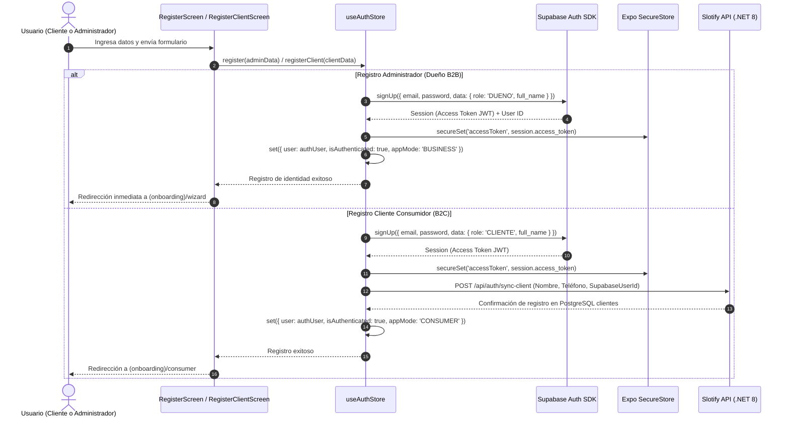

# 🔄 Flujo de Registro y Sync con Supabase Auth

> [!abstract] Resumen del Flujo
> Describe el proceso de creación de identidad digital en **Supabase Auth**, emisión del token criptográfico JWT, almacenamiento en **Expo SecureStore** y la sincronización con el backend en **.NET 8 / PostgreSQL**, distinguiendo claramente el flujo para clientes (B2C) y la delegación al Wizard para administradores (B2B).

---

## 🏛️ Diagrama Secuencial de Registro B2B y B2C

---

## 🛡️ Principios de Seguridad y Resiliencia

1. **Separación de Responsabilidades (SRP):** El módulo de autenticación no crea el negocio en la base de datos comercial; únicamente establece la identidad segura. La configuración del negocio se realiza de forma atómica en [[Feature Business Onboarding]].
2. **Sincronización Silenciosa:** Si la sesión de Supabase se restablece o se refresca el token en segundo plano, el listener `supabase.auth.onAuthStateChange` sincroniza de inmediato el estado de `useAuthStore` y actualiza SecureStore.
3. **Manejo Defensivo:** Si Supabase o la API responden con un error de correo duplicado o formato inválido, [[Gestion Centralizada de Errores (errorUtils)]] mapea el error para mostrarlo en [[FormErrorBanner y FormFieldError]].

---

## 🔗 Referencias Relacionadas
- Requerimiento: [[US-001 - Experiencia de Registro B2C y B2B]]
- Asistente de Negocio: [[Feature Business Onboarding]]
- Cliente Supabase: [[Supabase Auth Client]]
- MOC Principal: [[Indice General]]
