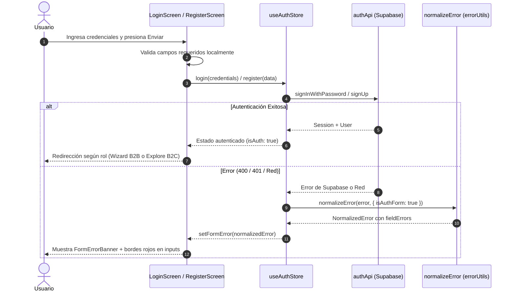

# 🔐 Feature Auth (UI)

> [!abstract] Resumen del Módulo
> `src/features/auth/` encapsula la experiencia visual y reactiva de autenticación, gestión de identidades, control de sesiones, roles duales (`DUENO` vs `CLIENTE`), inicio de sesión con Google y retroalimentación de error accesible con [[FormErrorBanner y FormFieldError]].

---

## 📁 Estructura del Módulo

```
src/features/auth/
├── api/
│   └── index.ts                 # authApi: login, loginWithGoogle, register, registerClient, logout, getSession
├── model/
│   └── index.ts                 # useAuthStore (Zustand + listener Supabase onAuthStateChange)
├── types/
│   └── index.ts                 # LoginCredentials, RegisterAdminRequest, RegisterClientRequest, AuthUser
└── ui/
    ├── FloatingBackgroundCards.tsx  # Fondo decorativo animado con tarjetas de citas flotantes
    ├── LoginScreen.tsx          # Pantalla de login con validación en vivo y FormErrorBanner
    ├── RegisterClientScreen.tsx # Registro para clientes consumidores (B2C)
    ├── RegisterScreen.tsx       # Registro de administradores de negocio (B2B)
    ├── RoleSelectionScreen.tsx  # Selector interactivo de modalidad (B2B vs B2C)
    └── WelcomeScreen.tsx        # Portada inicial de bienvenida
```

---

## 🖥️ Pantallas Principales y Manejo de Errores

### 1. `LoginScreen.tsx`
- **Validación Local Previa:** Comprueba presencia de correo y contraseña antes de despachar la petición.
- **Retroalimentación Defensiva:** Conectado a [[FormErrorBanner y FormFieldError]], capturando excepciones a través de [[Gestion Centralizada de Errores (errorUtils)]].
- **Acceso Directo Demo:** Credenciales de prueba (`demo@slotify.com`) para auditoría y evaluación rápida.
- **Reintento Inmediato:** Permite reintentar la autenticación desde el banner de error sin limpiar los campos ingresados.

### 2. `RegisterScreen.tsx` (Dueño de Negocio — B2B)
- Solicita nombre, apellido, correo electrónico y contraseña.
- Asigna automáticamente el rol `DUENO` en los metadatos de Supabase.
- **Desacoplamiento Arquitectónico:** Tras el registro exitoso, delega inmediatamente la configuración de negocio al asistente [[Feature Business Onboarding]] (`/(onboarding)/wizard`).

### 3. `RegisterClientScreen.tsx` (Cliente Consumidor — B2C)
- Captura teléfono móvil y nombre completo para sincronizar con la tabla de clientes.
- Asigna el rol `CLIENTE`, activa `appMode: 'CONSUMER'` y redirige al micro-onboarding [[Feature Consumer Onboarding]] (`/(onboarding)/consumer`).

---

## 🔄 Flujo de Autenticación y Manejo de Errores



---

## 🔗 Referencias Relacionadas
- Requerimiento: [[US-001 - Experiencia de Registro B2C y B2B]]
- Normalizador de Errores: [[Gestion Centralizada de Errores (errorUtils)]]
- Componentes Visuales de Error: [[FormErrorBanner y FormFieldError]]
- Wizard B2B: [[Feature Business Onboarding]]
- MOC Principal: [[Indice General]]
