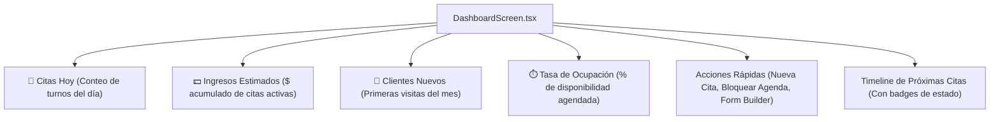

# 📊 Feature Business Dashboard

> [!abstract] Resumen del Módulo
> `src/features/dashboard/` es el centro de control operativo para dueños de negocio (`DUENO`). Presenta métricas clave de desempeño (KPIs) en tiempo real, listado de próximas citas, accesos rápidos a la agenda y acceso al creador de formularios dinámicos ([[Feature Dynamic Form Builder]]).

---

## 📁 Estructura del Módulo

```
src/features/dashboard/
└── ui/
    ├── components/
    │   ├── FormViewer.tsx             # Visor de formularios de reserva para pruebas y previews
    │   └── TemplateMigrationModal.tsx # Modal de actualización de plantillas de industria
    └── screens/
        ├── DashboardScreen.tsx        # Panel principal con métricas y citas de hoy
        └── FormBuilderScreen.tsx      # Editor interactivo de campos de formulario
```

---

## 📈 Indicadores Clave de Desempeño (KPIs)



---

## 🖥️ Componentes y Acciones Principales

1. **Tarjetas Métricas:** Presentan los 4 KPIs principales calculados automáticamente a partir de los datos de `useCalendarStore`.
2. **Timeline de Próximas Citas:** Muestra las citas del día ordenadas cronológicamente, con nombre del cliente, servicio solicitado, horario e indicador de estado (*confirmada*, *pendiente*, *en proceso*).
3. **Acciones Rápidas:**
   - **Agendar Cita:** Abre el modal de creación manual de citas (`CreateAppointmentModal`).
   - **Bloquear Horario:** Abre el modal de bloqueo manual ([[Feature Schedule Blocks]]).
   - **Formulario Personalizado:** Navega al editor visual [[Feature Dynamic Form Builder]].
4. **Manejo de Cero Datos:** Emplea [[EmptyStateCard]] cuando no hay citas programadas para el día, invitando a compartir el enlace de reserva.

---

## 🔗 Referencias Relacionadas
- Requerimiento: [[US-004 - Dashboard y Manejo de Estados Vacios (Empty States)]]
- Calendario: [[Feature Calendar & Booking]]
- Form Builder: [[Feature Dynamic Form Builder]]
- MOC Principal: [[Indice General]]
