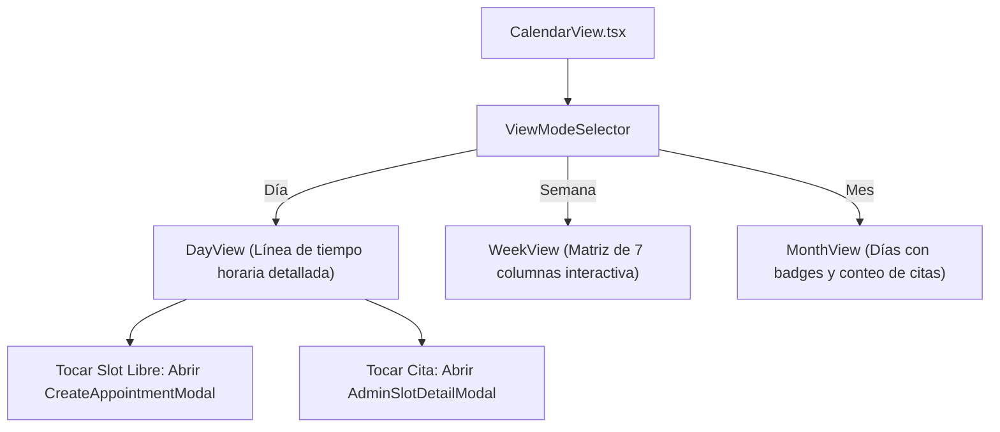

# 📅 Feature Calendar & Booking (Agenda Multiformato)

> [!abstract] Resumen del Módulo
> Engloba los módulos `src/features/calendar/` y `src/features/booking/`, encargados de la visualización táctil multiformato de la agenda (**Día**, **Semana** y **Mes**), gestión de citas en tiempo real, bloqueos de disponibilidad y agendamiento interactivo tanto para administradores como en la ruta pública `/book/[slug]`.

---

## 📁 Estructura de los Módulos

```
src/features/calendar/
├── api/
│   └── index.ts                 # fetchCalendarSlots(), createAppointment(), updateStatus()
├── model/
│   └── index.ts                 # useCalendarStore (Zustand)
├── ui/
│   ├── AdminSlotDetailModal.tsx # Detalle administrativo del turno (completar, cancelar, reprogramar)
│   ├── CalendarHeader.tsx       # Cabecera con selector de fecha, mes actual y botón Hoy
│   ├── CalendarSlotCard.tsx     # Tarjeta representativa de un slot o cita en la vista
│   ├── CalendarView.tsx         # Contenedor principal con conmutador de modos
│   ├── CreateAppointmentModal.tsx # Modal para agendar una cita manual con cliente y servicio
│   ├── DayView.tsx              # Vista cronológica de 24 horas con scroll táctil
│   ├── JumpToDateModal.tsx      # Selector rápido de fecha con calendario emergente
│   ├── MonthView.tsx            # Cuadrícula mensual con indicadores de densidad de citas
│   ├── QuickSearchModal.tsx     # Buscador de citas por nombre de cliente
│   ├── ViewModeSelector.tsx     # Segmented control para alternar Día / Semana / Mes
│   └── WeekView.tsx             # Vista de 7 columnas horizontales con sincronización horaria
src/features/booking/
├── model/
│   └── types.ts                 # Tipos BookingFormData y TimeSlot
└── ui/
    ├── components/
    │   └── DynamicBookingForm.tsx # Formulario de reserva con validaciones
    └── screens/
        └── BookingScreen.tsx    # Pantalla consumida por la ruta pública /book/[slug]
```

---

## 🎛️ Modos de Visualización del Calendario (US-003 / US-008)



1. **Vista de Día (`DayView`):** Renderiza franjas horarias continuas desde las 00:00 hasta las 23:00 con indicador de hora actual en vivo. Permite tocar cualquier slot libre para agendar de inmediato.
2. **Vista Semanal (`WeekView`):** Muestra los 7 días de la semana con sincronización de scroll vertical entre columnas.
3. **Vista Mensual (`MonthView`):** Cuadrícula de calendario tradicional donde cada celda muestra badges de colores según la saturación de reservas.

---

## 🛠️ Modales de Gestión Administrativa

- **`CreateAppointmentModal`:** Formulario completo para registrar citas en el momento (walk-ins o vía telefónica), seleccionando cliente, servicio, fecha, hora y notas.
- **`AdminSlotDetailModal`:** Permite al administrador cambiar el estado de la cita (`confirmed`, `completed`, `cancelled`) o invocar la reprogramación de fecha/hora.
- **Bloqueos de Horario:** Integración nativa con [[Feature Schedule Blocks]] para inhabilitar franjas horarias por descanso o mantenimiento.

---

## 🔗 Referencias Relacionadas
- Requerimiento: [[US-003 - Calendario Tactil y Seleccion de Turnos]]
- Bloqueos de Horario: [[Feature Schedule Blocks]]
- Formulario de Reserva: [[Feature Dynamic Form Builder]]
- MOC Principal: [[Indice General]]
