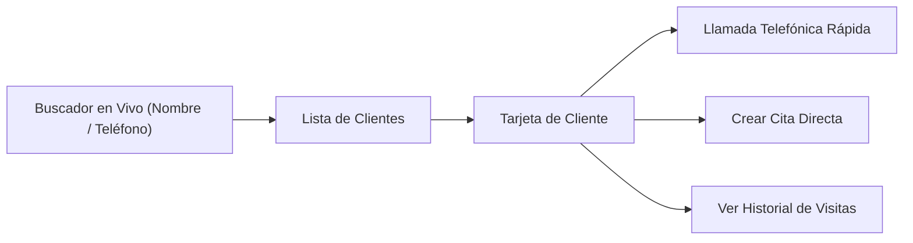

# 👥 Feature Clients (Directorio de Clientes B2B)

> [!abstract] Resumen del Módulo
> `src/features/clients/` proporciona al administrador del comercio un directorio centralizado para gestionar a sus clientes registrados (`ClientsScreen.tsx`), consultar su historial de citas, información de contacto directa y métricas de recurrencia.

---

## 📁 Estructura del Módulo

```
src/features/clients/
├── ui/
│   └── screens/
│       └── ClientsScreen.tsx    # Vista principal del directorio de clientes
└── (Integración progresiva con API .NET en US-026)
```

---

## 🔍 Funcionalidades de la Pantalla (`ClientsScreen.tsx`)



1. **Búsqueda Filtrada:** Permite localizar clientes de manera instantánea ingresando su nombre, apellido o número telefónico.
2. **Tarjeta de Información del Cliente:** Presenta nombre completo, teléfono formateado, última fecha de visita y total de citas acumuladas.
3. **Manejo de Colección Vacía:** Despliega un componente accesible con ilustración e invitación a compartir el enlace de reserva cuando aún no existen clientes registrados.

---

## 🔗 Referencias Relacionadas
- Historia de Usuario: [[US-026 - Directorio y Modulo de Clientes B2B]]
- Dashboard B2B: [[Feature Business Dashboard]]
- MOC Principal: [[Indice General]]
