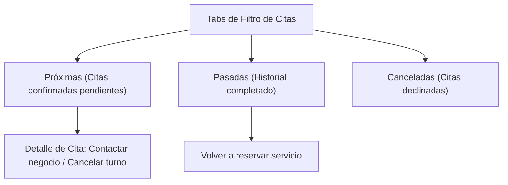

# 🛍️ Feature Consumer Dashboard & Explore

> [!abstract] Resumen del Módulo
> Gestiona la experiencia del cliente final (`CONSUMER` / `CLIENTE`), dividida arquitectónicamente en dos módulos desacoplados:
> 1. **Consumer Dashboard (`src/features/consumer-dashboard/`):** Pantalla *"Mis Citas"* para el seguimiento, reprogramación y cancelación de reservas activas e historial de visitas.
> 2. **Explore (`src/features/explore/`):** Motor independiente de búsqueda, filtrado y catálogo de comercios locales (detallado en [[Feature Explore]]).

---

## 📁 Estructura del Módulo `consumer-dashboard`

```
src/
├── app/(main)/
│   ├── index.tsx                         # Renderiza ConsumerDashboardScreen cuando appMode === 'CONSUMER'
│   └── explore.tsx                       # Renderiza ExploreScreen (Catálogo comercial)
└── features/
    ├── consumer-dashboard/
    │   └── ui/screens/
    │       └── ConsumerDashboardScreen.tsx # Vista de "Mis Citas" del consumidor
    └── explore/                          # 🔍 Módulo independiente (Ver nota Feature Explore)
```

---

## 📅 Pantalla de "Mis Citas" (`ConsumerDashboardScreen.tsx`)



### Capacidades Clave
1. **Pestañas de Filtrado Temporal:** Clasifica las citas en tres estados: *Próximas*, *Pasadas* y *Canceladas*.
2. **Tarjeta de Detalle de Cita:** Muestra nombre del comercio, servicio reservado, dirección, fecha y hora formateada, y estado con badge de color semántico.
3. **Acciones Rápidas:** Permite cancelar una cita con confirmación previa y disparar llamadas directas al teléfono del negocio.
4. **Estados Vacíos Contextuales:** Si el cliente no tiene reservas, despliega [[EmptyStateCard]] invitándolo a explorar negocios locales mediante un botón de acceso directo al explorador.

---

## 🔍 Módulo de Catálogo y Búsqueda
Para la documentación técnica del catálogo de negocios, chips de categorías y modales de reserva, consulta:
👉 **[[Feature Explore]]**

---

## 🔗 Referencias Relacionadas
- Catálogo y Descubrimiento: [[Feature Explore]]
- Flujo de Navegación: [[Flujo de Exploracion y Filtros de Negocio]]
- Micro-Onboarding: [[Feature Consumer Onboarding]]
- Barra Flotante: [[FloatingTabBar]]
- MOC Principal: [[Indice General]]
