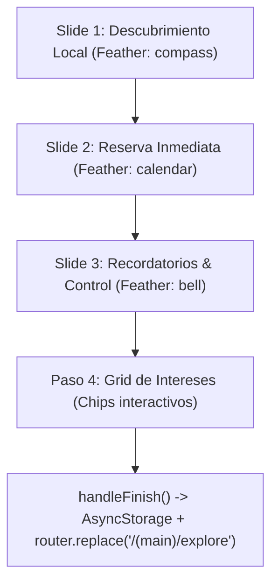

# ✨ Feature Consumer Onboarding

> [!abstract] Resumen del Módulo
> Gestiona la experiencia guiada de inducción para usuarios finales (clientes consumidores) al iniciar sesión por primera vez. Incluye carrusel de beneficios en 3 diapositivas, selector multicategoría y persistencia local en `AsyncStorage`.

---

## 📁 Estructura del Módulo

```
src/features/consumer-onboarding/
├── ui/
│   └── ConsumerOnboardingScreen.tsx  # Pantalla principal con carrusel y selector de tags
└── index.ts                          # Exportación pública
```

---

## ⚙️ Arquitectura y Estados Locales

La pantalla `ConsumerOnboardingScreen.tsx` gestiona:
- `currentIndex`: Índice activo del `FlatList` horizontal (`0` a `3`).
- `selectedInterests`: Array de IDs de categorías seleccionadas por el cliente (`['barberia', 'spa']`).
- `flatListRef`: Referencia interactiva para transiciones animadas con `scrollToIndex`.



---

## 💻 Persistencia de Finalización

```tsx
// src/features/consumer-onboarding/ui/ConsumerOnboardingScreen.tsx
const handleFinish = async () => {
  try {
    await AsyncStorage.setItem(STORAGE_KEYS.CONSUMER_ONBOARDING_COMPLETE, 'true');
    if (selectedInterests.length > 0) {
      await AsyncStorage.setItem('consumerInterests', JSON.stringify(selectedInterests));
    }
  } catch (e) {
    console.warn('Error saving consumer onboarding state:', e);
  }
  router.replace('/(main)/explore' as any);
};
```

---

## 🔗 Referencias Relacionadas
- Requerimiento: [[US-005 - Micro-Onboarding Interactivo del Consumidor]]
- Flujo: [[Flujo de Micro-Onboarding y Feed Inicial]]
- Explorador: [[Feature Consumer Dashboard & Explore]]
- Almacenamiento: [[Offline Storage y Cache]]
