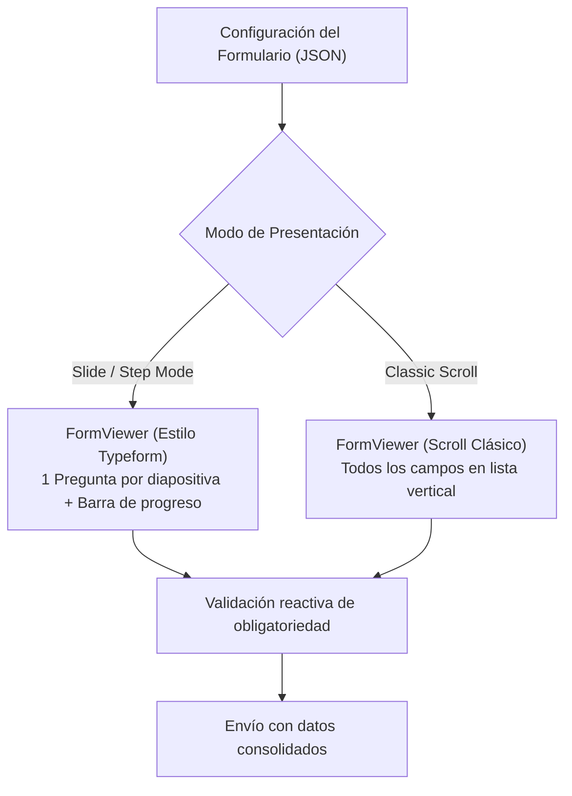

# 📝 Feature Dynamic Form Builder (Creador Dinámico de Formularios)

> [!abstract] Resumen del Módulo
> `src/features/dashboard/ui/screens/FormBuilderScreen.tsx` y su motor de renderizado `FormViewer.tsx` permiten a los negocios diseñar y previsualizar formularios de reserva a la medida sin escribir código. Soporta campos personalizados, validaciones obligatorias, y visualización bimodal (por diapositivas interactivas o scroll continuo).

---

## 📁 Archivos Relacionados en el Proyecto

```
src/
├── app/(main)/
│   ├── form-builder.tsx           # Ruta de acceso al constructor
│   └── form-preview.tsx           # Vista de previsualización en tiempo real
└── features/dashboard/
    └── ui/
        ├── components/
        │   └── FormViewer.tsx     # Motor de renderizado dinámico de formularios
        └── screens/
            └── FormBuilderScreen.tsx # Interfaz visual de edición y ordenamiento de campos
```

---

## 🛠️ Tipos de Campos Soportados

| Tipo de Campo | Componente de Renderizado | Uso Típico |
| :--- | :--- | :--- |
| `text` | `TextInput` de una línea | Nombre de acompañante, notas breves |
| `textarea` | `TextInput` multilínea | Alergias, solicitudes especiales o preferencias |
| `select` | Modal o Dropdown de opciones | Selección de especialista, zona o mesa |
| `checkbox` | Checkbox animado | Aceptación de términos, confirmación de requisitos |
| `number` | Teclado numérico restringido | Número de comensales o asistentes |
| `date` / `time` | Selectores de fecha y hora | Citas personalizadas |

---

## 🎨 Modos de Renderizado del Formulario



1. **Modo Diapositivas (Slides):** Diseñado para alta conversión móvil. Presenta una sola pregunta por pantalla con micro-animaciones en Reanimated, reduciendo la fatiga del usuario.
2. **Modo Clásico (Scroll):** Despliega el formulario completo en un scroll vertical tradicional, ideal para formularios cortos.

---

## 🔗 Referencias Relacionadas
- Historia de Usuario: [[US-020 - Creador Dinamico de Formularios (Form Builder)]]
- Componente FormViewer: [[FormViewer]]
- Dashboard B2B: [[Feature Business Dashboard]]
- MOC Principal: [[Indice General]]
