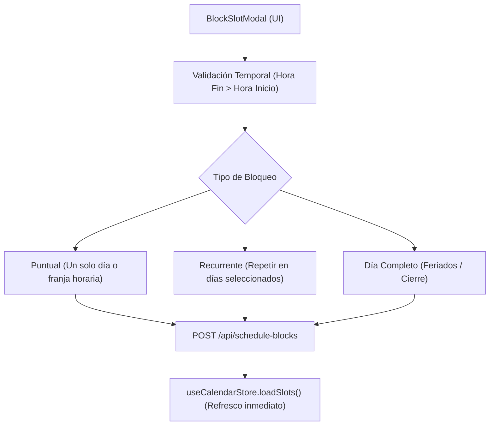

# 🚫 Feature Schedule Blocks (Bloqueos de Horario)

> [!abstract] Resumen del Módulo
> `src/features/schedule-blocks/` permite a los administradores y profesionales de negocio bloquear manualmente periodos de tiempo en su agenda (almuerzo, mantenimiento, emergencias o vacaciones), previniendo que los clientes reserven en esos intervalos y garantizando coherencia temporal en el calendario.

---

## 📁 Estructura del Módulo

```
src/features/schedule-blocks/
├── api/
│   └── index.ts                 # createBlock(), fetchBlocks(), deleteBlock()
├── model/
│   └── index.ts                 # useScheduleBlockStore (Zustand)
├── ui/
│   ├── BlockSlotModal.tsx       # Modal táctil de configuración del bloqueo
│   └── index.ts
└── index.ts
```

---

## 🛠️ Tipos de Bloqueo y Reglas de Negocio (US-023)



- **Motivo del Bloqueo (`reason`):** Texto explicativo visible solo para el personal del negocio.
- **Validación Estricta:** El modal valida que la hora de finalización sea posterior a la de inicio antes de permitir el envío.
- **Refresco Reactivo:** Al crearse un bloqueo exitosamente, se invalida la caché de slots de la agenda para reflejar el espacio sombreado e inhabilitado de inmediato.

---

## 💻 Integración del Store (`useScheduleBlockStore`)

```typescript
export interface ScheduleBlockFormState {
  blockType: 'single' | 'recurring' | 'allday';
  reason: string;
  startDate: string;
  endDate: string;
  startTime: string;
  endTime: string;
  repeatDays: string[];
  isLoading: boolean;

  setReason: (reason: string) => void;
  setTimeRange: (start: string, end: string) => void;
  reset: () => void;
}
```

---

## 🔗 Referencias Relacionadas
- Historia de Usuario: [[US-023 - Gestion de Bloqueos de Agenda y Citas]]
- Calendario: [[Feature Calendar & Booking]]
- Endpoints del Cliente: [[Slotify API Client]]
- MOC Principal: [[Indice General]]
