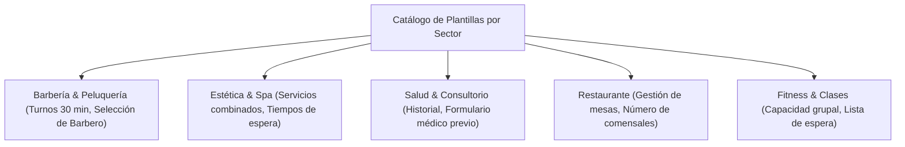

# 💈 Feature Sector Templates (Plantillas por Giro Comercial)

> [!abstract] Resumen del Módulo
> `src/features/sector-templates/` gestiona las configuraciones predeterminadas según el giro comercial del negocio (Barberías, Estéticas, Spas, Consultorios Médicos, Restaurantes y Servicios Profesionales), habilitando o deshabilitando módulos funcionales (anticipos, inventario, duración de slots) y campos personalizados de reserva.

---

## 📁 Estructura del Módulo

```
src/features/sector-templates/
├── api/
│   └── index.ts                 # fetchSectorTemplates() y sincronización de configuración
├── constants/
│   └── index.ts                 # Definición estática de SECTOR_TEMPLATES y módulos
├── model/
│   └── index.ts                 # useSectorTemplateStore (Zustand)
├── types/
│   └── index.ts                 # Interfaces SectorTemplate, IndustryModule, CustomField
├── ui/
│   ├── SectorSelectionScreen.tsx  # Pantalla de selección interactiva de industria
│   ├── SectorTemplateCard.tsx     # Tarjeta visual con iconos y módulos incluidos
│   └── SectorTemplateSelector.tsx # Selector compacto para modales de configuración
└── index.ts
```

---

## 🏛️ Giros Comerciales Soportados (`SECTOR_TEMPLATES`)



Cada plantilla define:
- `id` y `name`: Identificador canónico y título amigable.
- `defaultSlotDuration`: Duración estándar de los intervalos de agenda en minutos.
- `modules`: Módulos sugeridos (`inventory`, `staff_assignment`, `online_payments`, `deposit_required`).
- `customBookingFields`: Campos dinámicos inyectados en el formulario de reserva ([[Feature Dynamic Form Builder]]).

---

## ⚡ Estado y Acciones (`useSectorTemplateStore`)

```typescript
export interface SectorTemplateState {
  sectors: SectorTemplate[];
  activeSector: SectorTemplate | null;
  selectedModules: string[];
  customFields: CustomField[];
  isLoading: boolean;

  fetchSectors: () => Promise<void>;
  selectSector: (sectorId: string) => void;
  toggleModule: (moduleId: string) => void;
  saveConfiguration: () => Promise<void>;
}
```

---

## 🔗 Referencias Relacionadas
- Historia de Usuario: [[US-006 - Selector de Giro y Plantillas de Sector]]
- Onboarding B2B: [[Feature Business Onboarding]]
- Form Builder: [[Feature Dynamic Form Builder]]
- MOC Principal: [[Indice General]]
