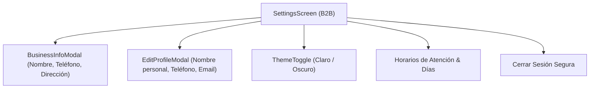

# ⚙️ Feature Settings & Profile (Configuración y Perfil)

> [!abstract] Resumen del Módulo
> Engloba los módulos `src/features/settings/` y `src/features/profile/`, responsables de la administración de la identidad del negocio, personalización del perfil del usuario, control del tema de la aplicación (*Light/Dark*) y conmutación entre modos (*B2B vs B2C*).

---

## 📁 Estructura de los Módulos

```
src/features/settings/
├── ui/
│   ├── components/
│   │   ├── BusinessInfoModal.tsx  # Modal de edición de datos comerciales
│   │   └── EditProfileModal.tsx   # Modal de edición de perfil de administrador
│   └── screens/
│       └── SettingsScreen.tsx     # Centro de configuración para dueños de negocio
src/features/profile/
└── ui/
    └── screens/
        └── ProfileScreen.tsx      # Vista de cuenta para consumidores y administradores
```

---

## 🛠️ Capacidades Principales



1. **Gestión de Información del Comercio (`BusinessInfoModal`):** Permite actualizar en tiempo real el nombre público, teléfono de atención al cliente y ubicación física del establecimiento.
2. **Edición de Perfil de Usuario (`EditProfileModal`):** Maneja la actualización de datos personales, validando formatos y sincronizando con Supabase Auth y la base de datos PostgreSQL.
3. **Control de Apariencia:** Conexión directa con `useThemeStore` para conmutar instantáneamente entre la paleta Dark Charcoal y el tema claro.
4. **Conmutación de Modo de App:** Permite a usuarios con credenciales duales alternar entre la vista de administración (`BUSINESS`) y el explorador de cliente (`CONSUMER`).

---

## 🔗 Referencias Relacionadas
- Sistema de Tema: [[Sistema de Diseno y Tokens]]
- Autenticación: [[Feature Auth (UI)]]
- MOC Principal: [[Indice General]]
