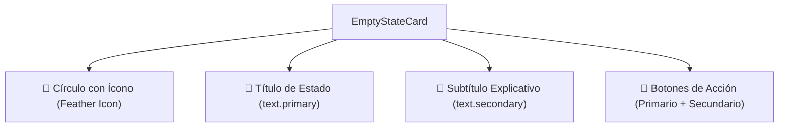

# 📭 EmptyStateCard

> [!abstract] Resumen del Componente
> `EmptyStateCard` es el patrón de interfaz estándar para colecciones sin datos en **Slotify** (citas no agendadas, listas de clientes vacías, resultados de búsqueda nulos). Transforma un estado potencialmente desalentador en una oportunidad guiada de interacción mediante llamadas a la acción (*Call to Action* o CTA) claras.

---

## 🎨 Anatomía y Propiedades del Componente



---

## 💻 Implementación en `DashboardScreen.tsx`

```tsx
// src/features/dashboard/ui/screens/DashboardScreen.tsx
<Animated.View
  entering={FadeInDown.duration(400)}
  style={[
    s.emptyStateCard,
    {
      backgroundColor: colors.background.secondary,
      borderColor: colors.border.main,
    },
  ]}
>
  <View
    style={[
      s.emptyIconCircle,
      { backgroundColor: isDark ? 'rgba(255,255,255,0.06)' : '#F3F4F6' },
    ]}
  >
    <Feather name="calendar" size={26} color={colors.text.muted} />
  </View>
  <Text style={[s.emptyStateTitle, { color: colors.text.primary }]}>
    Aún no tienes citas registradas
  </Text>
  <Text style={[s.emptyStateSubtitle, { color: colors.text.secondary }]}>
    Las citas que agenden tus clientes o agregues desde la agenda aparecerán aquí.
  </Text>
  <View style={s.emptyActionsRow}>
    <TouchableOpacity
      style={[s.emptyActionBtn, { backgroundColor: colors.action.primary }]}
      onPress={() => router.push('/(main)/agenda' as any)}
      activeOpacity={0.8}
    >
      <Feather name="plus-circle" size={15} color={colors.action.primaryText} />
      <Text style={[s.emptyActionBtnText, { color: colors.action.primaryText }]}>
        Crear Cita
      </Text>
    </TouchableOpacity>
    <TouchableOpacity
      style={[
        s.emptyShareBtn,
        {
          backgroundColor: isDark ? 'rgba(255,255,255,0.04)' : '#F9FAFB',
          borderColor: colors.border.main,
        },
      ]}
      onPress={handleShareLink}
      activeOpacity={0.7}
    >
      <Feather name="share-2" size={15} color={colors.text.primary} />
      <Text style={[s.emptyShareBtnText, { color: colors.text.primary }]}>
        Compartir
      </Text>
    </TouchableOpacity>
  </View>
</Animated.View>
```

---

## 🔗 Referencias Relacionadas
- Requerimiento: [[US-004 - Dashboard y Manejo de Estados Vacios (Empty States)]]
- Dashboard: [[Feature Business Dashboard]]
- Tokens y Tematización: [[Sistema de Diseno y Tokens]]
- MOC: [[Indice General]]
