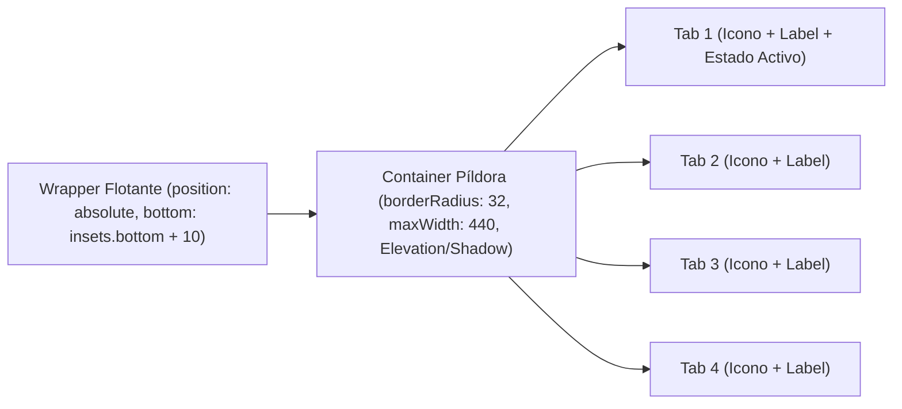

# 🛸 FloatingTabBar

> [!abstract] Resumen del Componente
> `FloatingTabBar` es la barra de navegación inferior flotante personalizada de **Slotify**. Está construida con soporte para **Safe Area Insets**, bordes translúcidos con efecto de cristal (*glassmorphism*), y filtrado dinámico de pestañas según la modalidad de usuario (`BUSINESS` vs `CONSUMER`).

---

## 📐 Propiedades y Configuración

Ubicado en `src/components/FloatingTabBar.tsx`:

```typescript
export interface FloatingTabBarProps {
  state: NavigationState;
  descriptors: Record<string, BottomTabDescriptor>;
  navigation: NavigationHelpers<ParamListBase, BottomTabNavigationEventMap>;
}
```

---

## 🎨 Filtrado Condicional de Rutas

El componente evalúa la propiedad `appMode` del store `useAuthStore`:

```tsx
// src/components/FloatingTabBar.tsx
const isBusiness = appMode === 'BUSINESS';

// Configuración de rutas permitidas
const allowedRouteNames = isBusiness
  ? ['index', 'agenda', 'clients', 'settings']
  : ['explore', 'index', 'settings'];

const visibleRoutes = state.routes.filter((route: any) =>
  allowedRouteNames.includes(route.name)
);
```

---

## 📱 Estructura Visual y Efectos



### Características de Estilo Clave
- **Elevación y Sombras Nativas:** Utiliza `shadowOffset: { width: 0, height: 10 }` en iOS y `elevation: 12` en Android.
- **Píldora Activa:** La pestaña seleccionada recibe un contenedor de alto contraste (`#171717` en modo claro / `#383838` en modo oscuro) con texto e ícono blancos.
- **Ocultamiento Inteligente:** Respeta `tabBarStyle: { display: 'none' }` en rutas que requieran pantalla completa (como formularios y constructores).

---

## 🔗 Referencias Relacionadas
- Enrutamiento: [[Enrutamiento y Navegacion]]
- Tokens y Colores: [[Sistema de Diseno y Tokens]]
- Estado de Sesión: [[Estado Global y Stores]]
- MOC Principal: [[Indice General]]
