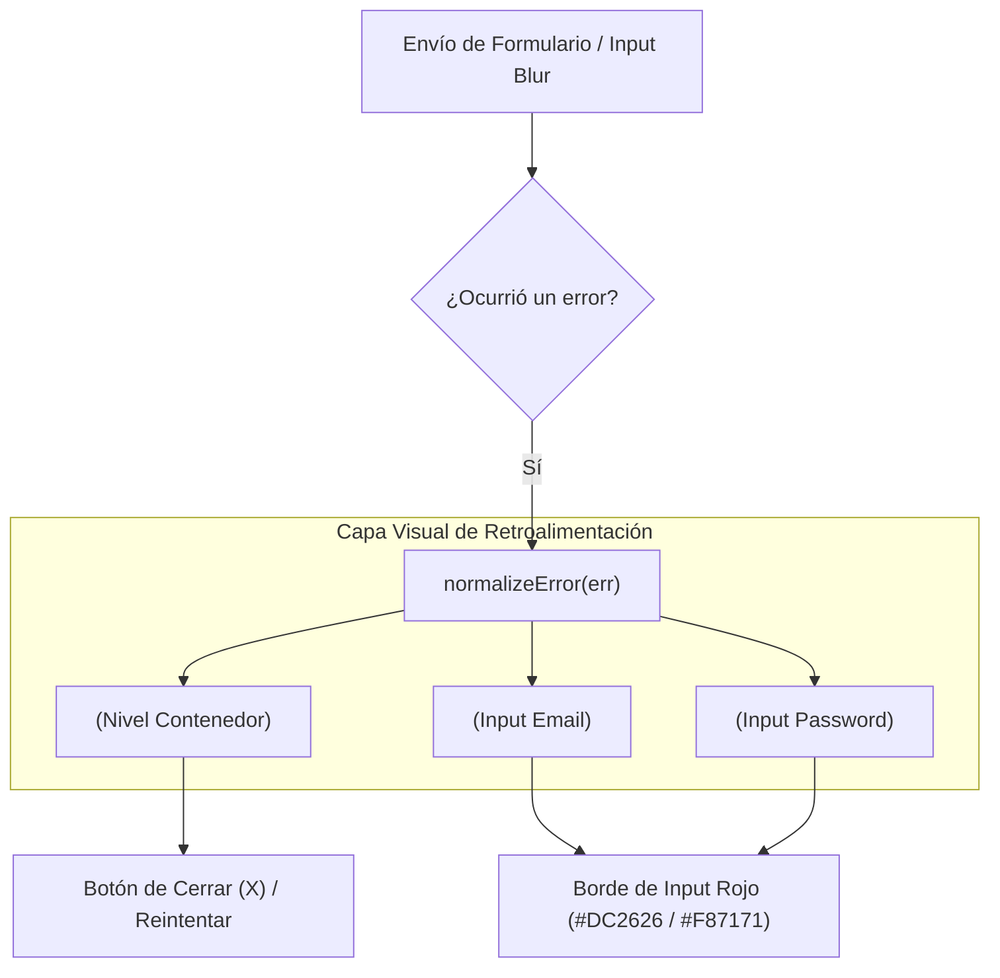

# ⚠️ FormErrorBanner y FormFieldError

> [!abstract] Resumen de Componentes
> Componentes de interfaz de usuario diseñados para ofrecer retroalimentación de error accesible, clara y no intrusiva en formularios. Operan en conjunto con la capa de [[Gestion Centralizada de Errores (errorUtils)]] para presentar alertas globales con reintento y mensajes contextuales debajo de cada campo individual.

---

## 🏛️ Jerarquía Visual de Errores en Formularios



---

## 1. `FormErrorBanner` (`src/components/ui/FormErrorBanner.tsx`)

Muestra una tarjeta de alerta prominente en la parte superior del formulario cuando una operación falla.

### Propiedades (`FormErrorBannerProps`)

```typescript
interface FormErrorBannerProps {
  /** Error a mostrar: objeto NormalizedError o mensaje en texto */
  error?: NormalizedError | string | null;
  /** Callback para descartar la alerta */
  onDismiss?: () => void;
  /** Callback para reintentar la acción que falló */
  onRetry?: () => void;
  /** Estilos opcionales para el contenedor */
  style?: StyleProp<ViewStyle>;
}
```

### Características Clave
- **Accesibilidad:** Configurado con `accessibilityRole="alert"` y `accessibilityLiveRegion="polite"`.
- **Modo Oscuro / Claro:** Aplica contraste reforzado (`#2D1214` en oscuro con borde `#7F1D1D`, `#FEE2E2` en claro con borde `#FCA5A5`).
- **Desglose de Campos:** Si el error incluye `fieldErrors`, renderiza una lista de viñetas con los detalles específicos reportados por el backend.
- **Botón de Reintento:** Incorpora acción interactiva rápida con icono `refresh-cw` para facilitar la recuperación del usuario sin recargar la pantalla.

---

## 2. `FormFieldError` (`src/components/ui/FormFieldError.tsx`)

Renderiza un mensaje compacto y directo inmediatamente debajo de un `TextInput` cuando un campo no cumple con las reglas de validación.

### Propiedades (`FormFieldErrorProps`)

```typescript
interface FormFieldErrorProps {
  /** Mensaje de error para el campo específico */
  error?: string | null;
  /** Estilos adicionales para el contenedor */
  style?: StyleProp<ViewStyle>;
}
```

### Características Clave
- **Visualización Condicional:** Retorna `null` si `error` es nulo o indefinido, ocupando cero espacio en el layout.
- **Iconografía:** Acompaña el texto con un icono `alert-circle` de 12 dp para reforzar la indicación visual a usuarios con daltonismo.
- **Colores:** Se adapta dinámicamente al tema (`#F87171` en dark mode, `#DC2626` en light mode).

---

## 💻 Patrón de Integración Recomendado

```tsx
import React, { useState } from 'react';
import { View, TextInput, TouchableOpacity, Text } from 'react-native';
import { FormErrorBanner } from '@/components/ui/FormErrorBanner';
import { FormFieldError } from '@/components/ui/FormFieldError';
import { normalizeError, type NormalizedError } from '@/shared/lib/errorUtils';
import { useAppTheme } from '@/shared/theme';

export const ExampleForm = () => {
  const { colors } = useAppTheme();
  const [email, setEmail] = useState('');
  const [error, setError] = useState<NormalizedError | null>(null);

  const handleSave = async () => {
    try {
      setError(null);
      await submitData({ email });
    } catch (err) {
      setError(normalizeError(err, { isAuthForm: true }));
    }
  };

  return (
    <View style={{ padding: 16 }}>
      {/* 1. Alerta Global */}
      <FormErrorBanner 
        error={error} 
        onDismiss={() => setError(null)} 
        onRetry={handleSave} 
      />

      {/* 2. Campo con Borde Reactivo y Mensaje */}
      <TextInput
        value={email}
        onChangeText={(val) => {
          setEmail(val);
          // Limpiar error del campo al escribir
          if (error?.fieldErrors?.email) {
            setError((prev) => prev ? {
              ...prev,
              fieldErrors: { ...prev.fieldErrors, email: undefined }
            } : null);
          }
        }}
        style={{
          borderWidth: 1,
          borderColor: error?.fieldErrors?.email ? colors.status.error : colors.border.main,
          padding: 12,
          borderRadius: 8,
          backgroundColor: colors.background.tertiary,
          color: colors.text.primary,
        }}
      />
      <FormFieldError error={error?.fieldErrors?.email} />
    </View>
  );
};
```

---

## 🔗 Referencias Relacionadas
- Normalizador de Errores: [[Gestion Centralizada de Errores (errorUtils)]]
- Autenticación: [[Feature Auth (UI)]]
- Tokens y Colores: [[Sistema de Diseno y Tokens]]
- MOC Principal: [[Indice General]]
