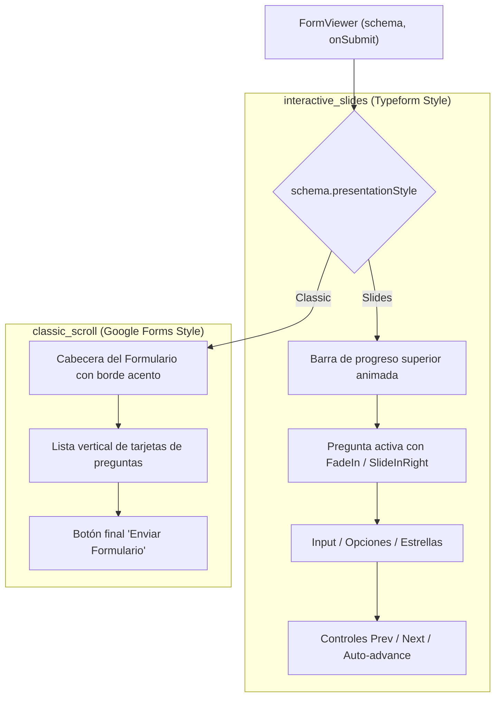

# 📝 FormViewer

> [!abstract] Resumen del Componente
> `FormViewer` es un motor de renderizado de esquemas JSON de formularios dinámicos. Soporta dos paradigmas visuales (*Interactive Slides / Typeform* y *Classic Scroll / Google Forms*), validación de campos obligatorios, animaciones fluidas con **React Native Reanimated** y auto-avance en preguntas de selección única.

---

## 📐 Interfaces del Esquema de Formulario (`FormSchema`)

Ubicado en `src/features/dashboard/ui/screens/FormBuilderScreen.tsx` y consumido por `FormViewer.tsx`:

```typescript
export type FieldType = 'short_text' | 'paragraph' | 'single_choice' | 'multiple_choice' | 'rating_stars';

export interface FormField {
  id: string;
  question: string;
  type: FieldType;
  required: boolean;
  options?: string[]; // Solo para single_choice o multiple_choice
}

export interface FormSchema {
  id: string;
  title: string;
  description?: string;
  accentColor: string;
  presentationStyle: 'interactive_slides' | 'classic_scroll';
  fields: FormField[];
}

export interface FormViewerProps {
  schema: FormSchema;
  onSubmit: (answers: Record<string, any>) => void;
  onCancel?: () => void;
}
```

---

## 🎭 Modos de Presentación



---

## 💻 Tipos de Campos Soportados

1. **Texto Corto (`short_text`):** Entrada de una sola línea estilizada.
2. **Párrafo (`paragraph`):** `TextInput` multilínea con altura mínima de 100px.
3. **Opción Única (`single_choice`):** Tarjetas seleccionables con auto-avance opcional en modo slides.
4. **Opción Múltiple (`multiple_choice`):** Checkbox cuadrado con soporte para arreglo de strings.
5. **Calificación por Estrellas (`rating_stars`):** 5 estrellas interactivas con `AntDesign (star / staro)`.

---

## 🔗 Referencias Relacionadas
- Requerimiento: [[US-004 - Dashboard y Manejo de Estados Vacios (Empty States)]]
- Flujo: [[Flujo de Agendamiento y Formularios Dinamicos]]
- Dashboard B2B: [[Feature Business Dashboard]]
- UI Kit: [[FloatingTabBar]]
