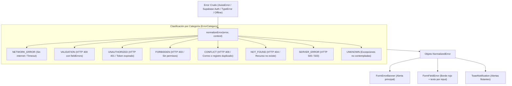

# 🛡️ Gestión Centralizada de Errores (errorUtils)

> [!abstract] Resumen del Módulo
> `src/shared/lib/errorUtils.ts` proporciona la capa unificada para interceptar, normalizar y traducir cualquier fallo en tiempo de ejecución (errores de red, respuestas HTTP de la API .NET, excepciones de autenticación de Supabase y fallos genéricos) en estructuras fuertemente tipadas (`NormalizedError`) listas para el consumo de la interfaz de usuario.

---

## 🏛️ Arquitectura de Normalización

El frontend opera bajo el principio de **Zero Trust y UX Defensiva**: la interfaz nunca expone trazas de depuración ni códigos crudos al usuario final. Todas las excepciones son canalizadas a través de `normalizeError()`.



---

## 📐 Tipos e Interfaces (`NormalizedError`)

Ubicados en `src/shared/lib/errorUtils.ts`:

```typescript
export type ErrorCategory =
  | 'VALIDATION'
  | 'UNAUTHORIZED'
  | 'FORBIDDEN'
  | 'NOT_FOUND'
  | 'CONFLICT'
  | 'SERVER_ERROR'
  | 'NETWORK_ERROR'
  | 'UNKNOWN';

export interface NormalizedError {
  /** Título conciso del error para encabezados de alerta */
  title: string;
  /** Mensaje principal claro y comprensible sin detalles técnicos */
  message: string;
  /** Categoría normalizada para lógica de presentación y telemetría */
  category: ErrorCategory;
  /** Código de estado HTTP si aplica */
  status?: number;
  /** Errores asociados a campos específicos del formulario (ej. { email: "Ya registrado" }) */
  fieldErrors?: Record<string, string>;
  /** Indica si la sesión realmente ha expirado (requiere reautenticación) */
  isSessionExpired?: boolean;
}
```

---

## 🔍 Reglas de Procesamiento por Fuente de Error

### 1. Errores de Red y Desconexión
- **Condición:** `error.code === 'ERR_NETWORK'`, `ECONNABORTED`, `Network request failed` o `timeout`.
- **Salida:** `category: 'NETWORK_ERROR'`.
- **Mensaje:** "No pudimos conectar con el servidor. Revisa tu conexión a internet e inténtalo de nuevo."

### 2. Errores de Validación (HTTP 400 Bad Request)
- **Problem Details de ASP.NET Core:** Parsea `response.data.errors` estructurado como diccionario `Record<string, string[]>`.
- **Arrays planos de errores:** Parsea listas de cadenas `errors: string[]`.
- **Mapeo a inputs:** Transforma las claves del backend a minúsculas (`Email` $\to$ `email`, `BusinessName` $\to$ `businessName`) para activar automáticamente los `FormFieldError`.

### 3. Autenticación y Credenciales (HTTP 401)
- **Distinción contextual:**
  - Si la petición proviene de un formulario de login/registro (`context.isAuthForm === true` o endpoint `/auth/*`), el mensaje se traduce como *"Credenciales inválidas"* sin forzar el deslogueo global.
  - Si proviene de una llamada operativa en un módulo protegido, se marca `isSessionExpired: true` para activar el redireccionamiento seguro.

### 4. Conflictos y Duplicados (HTTP 409)
- Identifica colisiones de correos electrónicos ya registrados en Supabase o nombres de negocio ya existentes en la base de datos PostgreSQL.

### 5. Supabase Auth Errors
- Mapea códigos de error específicos del cliente Supabase:
  - `invalid_credentials`: "El correo o la contraseña son incorrectos."
  - `user_already_exists`: "Ya existe una cuenta con este correo electrónico."
  - `weak_password`: "La contraseña debe tener al menos 6 caracteres."

---

## 💻 Ejemplo de Uso en Formularios

```typescript
import { normalizeError, type NormalizedError } from '@/shared/lib/errorUtils';
import { FormErrorBanner } from '@/components/ui/FormErrorBanner';
import { FormFieldError } from '@/components/ui/FormFieldError';

export const MyFormScreen = () => {
  const [errorState, setErrorState] = useState<NormalizedError | null>(null);

  const handleSubmit = async () => {
    try {
      setErrorState(null);
      await apiCall();
    } catch (err) {
      const normalized = normalizeError(err, { isAuthForm: true });
      setErrorState(normalized);
    }
  };

  return (
    <View>
      <FormErrorBanner 
        error={errorState} 
        onDismiss={() => setErrorState(null)} 
        onRetry={handleSubmit} 
      />
      <TextInput />
      <FormFieldError error={errorState?.fieldErrors?.email} />
    </View>
  );
};
```

---

## 🧪 Pruebas Unitarias Asociadas

La robustez de esta capa se valida exhaustivamente en `__tests__/formErrorHandling.test.ts`, cubriendo:
1. Normalización de HTTP 400 ProblemDetails con múltiples campos.
2. Manejo de desconexiones y timeout con mensaje amigable.
3. Tratamiento de HTTP 409 y 403 con preservación de campos.
4. Fallback seguro ante objetos de error malformados o nulos.

---

## 🔗 Referencias Relacionadas
- Cliente API: [[Slotify API Client]]
- Componentes de Error: [[FormErrorBanner y FormFieldError]]
- Store de Autenticación: [[Estado Global y Stores]]
- MOC Principal: [[Indice General]]
