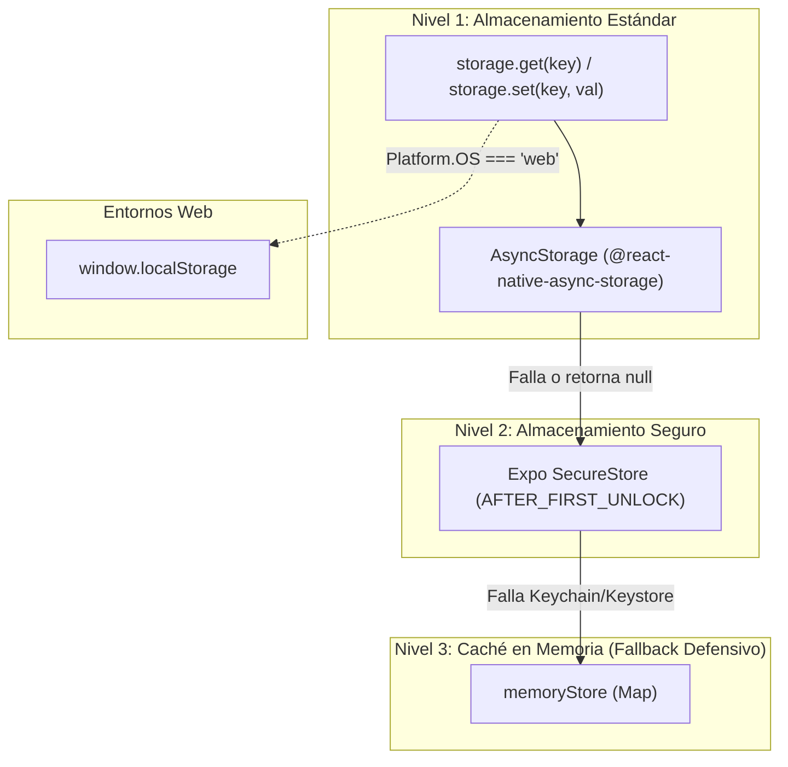

# 💾 Offline Storage y Capa de Caché

> [!abstract] Resumen del Módulo
> `src/shared/lib/storage.ts` implementa una estrategia de persistencia multinivel que unifica **AsyncStorage** (para preferencias generales), **Expo SecureStore** (para tokens JWT y credenciales confidenciales) y un **In-Memory Map** de contingencia ante bloqueos de hardware nativo (Keychain/Keystore) o entornos Web.

---

## 🏛️ Arquitectura Multinivel y Resiliencia



---

## 💻 Implementación Actual (`src/shared/lib/storage.ts`)

```typescript
import AsyncStorage from '@react-native-async-storage/async-storage';
import * as SecureStore from 'expo-secure-store';
import { Platform } from 'react-native';

const memoryStore = new Map<string, string>();

const sanitizeKey = (key: string) =>
  key.replace(/[^a-zA-Z0-9._-]/g, '_');

const parseValue = <T>(raw: string): T => {
  try {
    return JSON.parse(raw) as T;
  } catch {
    return raw as unknown as T;
  }
};

export const storage = {
  // Lectura con cascada de resiliencia
  get: async <T = string>(key: string): Promise<T | null> => {
    try {
      const raw = await AsyncStorage.getItem(key);
      if (raw !== null) return parseValue<T>(raw);
    } catch {
      // AsyncStorage no disponible: intentar SecureStore
    }

    try {
      const secureValue = await storage.secureGet(sanitizeKey(key));
      if (secureValue !== null) return parseValue<T>(secureValue);
    } catch {
      // SecureStore no disponible: recurrir a memoria
    }

    const memoryValue = memoryStore.get(key);
    return memoryValue !== undefined ? parseValue<T>(memoryValue) : null;
  },

  // Escritura con persistencia en memoria y fallback seguro
  set: async <T>(key: string, value: T): Promise<void> => {
    const stringified = typeof value === 'string' ? value : JSON.stringify(value);
    if (stringified === undefined) {
      throw new Error(`[Storage] Value for "${key}" cannot be serialized.`);
    }

    try {
      await AsyncStorage.setItem(key, stringified);
      memoryStore.set(key, stringified);
      return;
    } catch {
      // Intentar SecureStore si AsyncStorage falla
    }

    try {
      await storage.secureSet(sanitizeKey(key), stringified);
      memoryStore.set(key, stringified);
      return;
    } catch {
      // Último recurso: memoria volátil de proceso
      memoryStore.set(key, stringified);
    }
  },

  // Eliminación simultánea garantizada
  remove: async (key: string): Promise<void> => {
    memoryStore.delete(key);
    const results = await Promise.allSettled([
      AsyncStorage.removeItem(key),
      storage.secureRemove(sanitizeKey(key)),
    ]);

    if (results.every((result) => result.status === 'rejected')) {
      throw new Error(`[Storage] Could not remove "${key}" from persistent storage.`);
    }
  },

  clear: async (): Promise<void> => {
    memoryStore.clear();
    await AsyncStorage.clear();
  },

  // SecureStore nativo para iOS y Android
  secureGet: async (key: string): Promise<string | null> => {
    if (Platform.OS === 'web') {
      return typeof window !== 'undefined' ? window.localStorage.getItem(key) : null;
    }
    return SecureStore.getItemAsync(key, {
      keychainAccessible: SecureStore.AFTER_FIRST_UNLOCK,
    });
  },

  secureSet: async (key: string, value: string): Promise<void> => {
    if (Platform.OS === 'web') {
      if (typeof window !== 'undefined') window.localStorage.setItem(key, value);
      return;
    }
    await SecureStore.setItemAsync(key, value, {
      keychainAccessible: SecureStore.AFTER_FIRST_UNLOCK,
    });
  },

  secureRemove: async (key: string): Promise<void> => {
    if (Platform.OS === 'web') {
      if (typeof window !== 'undefined') window.localStorage.removeItem(key);
      return;
    }
    await SecureStore.deleteItemAsync(key);
  },
};
```

---

## 🔑 Claves Estándar (`STORAGE_KEYS`)

Centralizadas en `src/shared/lib/constants.ts`:

| Clave | Nombre en Storage | Tipo de Almacenamiento | Propósito |
| :--- | :--- | :---: | :--- |
| `ACCESS_TOKEN` | `accessToken` | Seguro (`secureSet`) | Token JWT de acceso para llamadas a la API .NET |
| `REFRESH_TOKEN` | `refreshToken` | Seguro (`secureSet`) | Token de refresco de sesión Supabase |
| `USER_DATA` | `userData` | General (`set`) | Metadatos y rol del usuario activo (`AuthUser`) |
| `THEME_MODE` | `themeMode` | General (`set`) | Preferencia de tema (`'light' \| 'dark' \| 'system'`) |
| `ONBOARDING_COMPLETE` | `onboardingComplete` | General (`set`) | Flag de finalización de inducción B2B |
| `CONSUMER_ONBOARDING_COMPLETE` | `consumerOnboardingComplete` | General (`set`) | Flag de micro-onboarding B2C |

---

## 🧪 Pruebas Unitarias (`storage.test.ts`)

La capa de almacenamiento cuenta con suite de pruebas en `src/shared/lib/__tests__/storage.test.ts`:
- **Lectura estándar:** Comprueba obtención desde AsyncStorage.
- **Cascada a SecureStore:** Valida recuperación transparente cuando AsyncStorage retorna `null`.
- **Resiliencia ante fallos totales:** Verifica que los datos se conservan en `memoryStore` aun cuando ambos subsistemas nativos arrojen excepciones.
- **Eliminación limpia:** Asegura que `remove()` ejecuta la limpieza en paralelo en ambos almacenes.

---

## 🔗 Referencias Relacionadas
- Cliente API: [[Slotify API Client]]
- Cliente Supabase: [[Supabase Auth Client]]
- Sistema de Diseño y Tema: [[Sistema de Diseno y Tokens]]
- MOC Principal: [[Indice General]]
