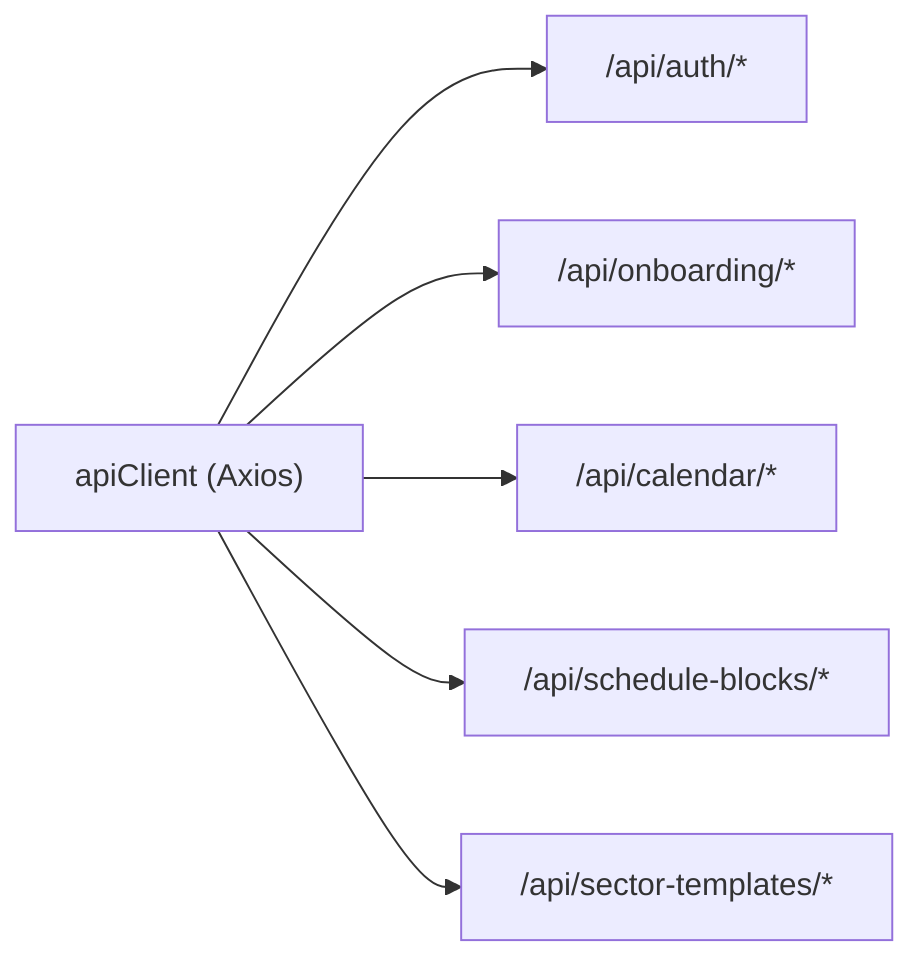

# 🌐 Slotify API Client (.NET 8 Backend)

> [!abstract] Resumen del Cliente HTTP
> Instancia centralizada de **Axios** configurada para comunicarse con el backend RESTful en **.NET 8 (Slotify_back)**. Incorpora inyección automática del token de portador (*Bearer JWT*) en cabeceras HTTP, recuperación resiliente de sesión con **Supabase Auth** y captura controlada de errores `401 Unauthorized`.

---

## 🔧 Archivo de Configuración (`src/shared/lib/api.ts`)

```typescript
import axios from 'axios';
import { storage } from './storage';
import { supabase } from './supabase';

const API_BASE_URL = process.env.EXPO_PUBLIC_API_URL ?? 'http://localhost:5272/api';

export const apiClient = axios.create({
  baseURL: API_BASE_URL,
  timeout: 15000,
  headers: {
    'Content-Type': 'application/json',
  },
});

// Interceptor de Petición — Inyecta token JWT de SecureStore con fallback a Supabase
apiClient.interceptors.request.use(
  async (config) => {
    let token = await storage.secureGet('accessToken');

    // Resiliencia: si el token no está en storage, consultar sesión activa de Supabase
    if (!token) {
      try {
        const { data } = await supabase.auth.getSession();
        if (data.session?.access_token) {
          token = data.session.access_token;
          await storage.secureSet('accessToken', token);
        }
      } catch {
        // Fallback silencioso si el SDK nativo no está disponible
      }
    }

    if (token) {
      config.headers.Authorization = `Bearer ${token}`;
    }
    return config;
  },
  (error) => Promise.reject(error),
);

// Interceptor de Respuesta — Maneja 401 discriminando endpoints de autenticación
apiClient.interceptors.response.use(
  (response) => response,
  async (error) => {
    const status = error.response?.status;
    const requestUrl = error.config?.url || '';

    // Endpoints de autenticación y sincronización NO deben desautenticar la sesión global
    const isAuthEndpoint =
      requestUrl.includes('/auth/login') ||
      requestUrl.includes('/auth/register') ||
      requestUrl.includes('/auth/sync');

    if (status === 401 && !isAuthEndpoint) {
      // Sesión expirada real en módulos protegidos: limpiar tokens
      await storage.secureRemove('accessToken');
      await storage.secureRemove('refreshToken');
    }
    return Promise.reject(error);
  },
);

export default apiClient;
```

---

## 📡 Endpoints Centralizados (`API_ENDPOINTS`)

Ubicados en `src/shared/lib/constants.ts`:



| Módulo / Historia | Endpoint | Método | Descripción |
| :--- | :--- | :---: | :--- |
| **Auth** | `/auth/login` | `POST` | Autenticación con credenciales |
| **Auth** | `/auth/register` | `POST` | Registro de nuevos usuarios |
| **Auth** | `/auth/sync` | `POST` | Sincronización de perfil de administrador |
| **Auth** | `/auth/sync-client` | `POST` | Sincronización de cliente en tabla PostgreSQL |
| **Onboarding B2B** | `/onboarding/complete-business-onboarding` | `POST` | Creación del negocio y configuración final del wizard |
| **US-006 / US-002** | `/sector-templates` | `GET` | Catálogo de plantillas y módulos por giro comercial |
| **US-003** | `/calendar/slots` | `GET` | Consulta de citas y disponibilidad por rango de fechas |
| **US-008 / US-023** | `/schedule-blocks` | `POST` | Creación de bloqueo de disponibilidad |
| **US-008 / US-023** | `/schedule-blocks/:id` | `DELETE` | Eliminación de bloqueo de horario |

---

## 🛡️ Manejo Defensivo de Errores

El cliente HTTP no expone los errores directamente a los componentes de interfaz. En su lugar:
1. El interceptor rechaza la promesa con el objeto `AxiosError`.
2. Las acciones de los stores (como `useAuthStore`, `useCalendarStore`, `useBusinessOnboardingStore`) capturan la excepción en un bloque `catch`.
3. Se invoca [[Gestion Centralizada de Errores (errorUtils)]] para transformar el error en un `NormalizedError` accesible.

---

## 🔗 Referencias Relacionadas
- Normalización de Errores: [[Gestion Centralizada de Errores (errorUtils)]]
- Almacenamiento Seguro: [[Offline Storage y Cache]]
- Supabase Auth: [[Supabase Auth Client]]
- Store Global: [[Estado Global y Stores]]
- MOC Principal: [[Indice General]]
