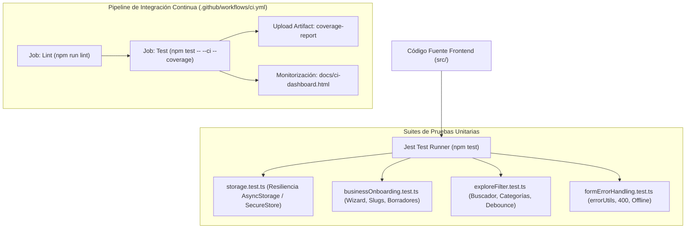

# 🧪 Estrategia de Pruebas Unitarias y CI Pipeline

> [!abstract] Resumen de la Guía
> Detalla la infraestructura de aseguramiento de calidad del frontend de **Slotify**, que abarca pruebas unitarias e integración con **Jest** y **@testing-library/react-native**, configuración de mocks nativos en `jest-setup-mock.js`, pipeline automatizado en **GitHub Actions** (`ci.yml`) y visualización de resultados en `docs/ci-dashboard.html`.

---

## 🏛️ Arquitectura de Testing



---

## ⚙️ Configuración del Entorno de Pruebas

### 1. Configuración de Jest (`jest.config.js`)
El proyecto extiende el preset de Expo para transformar módulos nativos:
```javascript
module.exports = {
  preset: 'jest-expo',
  setupFilesAfterEnv: ['./jest-setup-mock.js'],
  transformIgnorePatterns: [
    'node_modules/(?!((jest-)?react-native|@react-native(-community)?)|expo(nent)?|@expo(nent)?/.*|@expo-google-fonts/.*|react-navigation|@react-navigation/.*|@supabase/.*)',
  ],
};
```

### 2. Mocks de Módulos Nativos (`jest-setup-mock.js`)
Aísla las llamadas a hardware nativo durante la ejecución en Node.js:
- `@react-native-async-storage/async-storage`: Simulación en memoria de `getItem`, `setItem`, `removeItem`.
- `expo-secure-store`: Simulación de Keychain y Keystore nativo.
- `react-native-reanimated`: Mocks automáticos de animaciones.

---

## 📋 Inventario de Suites de Pruebas Implementadas

| Suite de Pruebas | Ubicación | Cobertura Funcional |
| :--- | :--- | :--- |
| **Storage Resiliente** | `src/shared/lib/__tests__/storage.test.ts` | Cascada AsyncStorage $\to$ SecureStore $\to$ Memory y excepciones de hardware. |
| **Business Onboarding** | `src/features/business-onboarding/__tests__/businessOnboarding.test.ts` | Avance de los 5 pasos, cálculo de slug sanitizado, guardado y restauración de borrador. |
| **Filtros de Explore** | `__tests__/exploreFilter.test.ts` | Búsqueda por coincidencia parcial, filtrado horizontal por chips y reseteo. |
| **Normalización de Errores** | `__tests__/formErrorHandling.test.ts` | ProblemDetails HTTP 400, errores de red y timeout, 409 duplicados y binding con `FormErrorBanner`. |

---

## 🚀 Pipeline de Integración Continua (GitHub Actions)

Ubicado en `.github/workflows/ci.yml`, el flujo se dispara ante `push` y `pull_request` a las ramas `main` y `sprint-*`:
1. **Linting:** Valida la estructura del código y formato.
2. **Ejecución de Pruebas:** Ejecuta `npm test -- --ci --coverage --forceExit`.
3. **Reporte de Cobertura:** Genera artefactos de cobertura descargables en GitHub Actions.
4. **Dashboard de Monitorización:** La carpeta de documentación incluye `docs/ci-dashboard.html`, un panel interactivo que resume métricas de ejecución y rendimiento del pipeline.

---

## 💻 Comandos de Ejecución Local

```bash
# Ejecutar todas las pruebas unitarias
npm test

# Ejecutar pruebas en modo observador (watch mode)
npx jest --watch

# Ejecutar una suite específica
npx jest __tests__/formErrorHandling.test.ts

# Generar reporte de cobertura local
npx jest --coverage
```

---

## 🔗 Referencias Relacionadas
- Normalización de Errores: [[Gestion Centralizada de Errores (errorUtils)]]
- Almacenamiento Seguro: [[Offline Storage y Cache]]
- Asistente de Negocio: [[Feature Business Onboarding]]
- MOC Principal: [[Indice General]]
